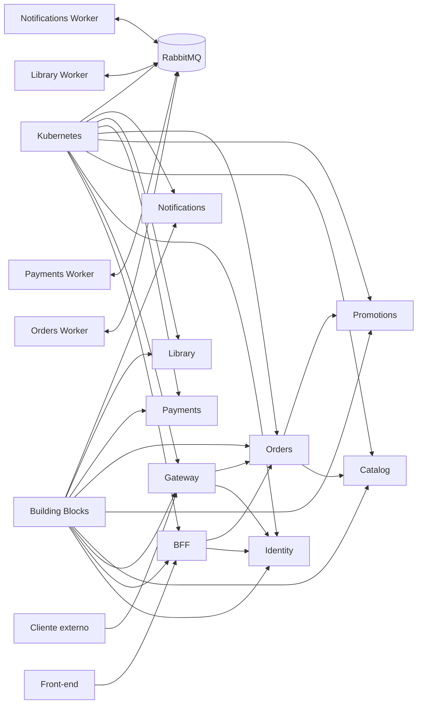

# Roteiro de migração para repositórios independentes

## Escopo confirmado

Os módulos de domínio são somente:

1. Identity;
2. Catalog;
3. Promotions;
4. Orders;
5. Payments;
6. Library;
7. Notifications.

Também fazem parte da solução, sem serem novos módulos de domínio:

- Building Blocks, como biblioteca compartilhada;
- Web BFF, como borda do front-end;
- API Gateway, como borda de clientes externos;
- RabbitMQ, como infraestrutura de mensageria;
- Kubernetes, como plataforma de execução.

O monólito será preservado durante a migração. Todo código novo será criado nos
novos repositórios.

## Repositórios planejados

### Domínio

| Ordem | Repositório | Aplicações | Banco |
|---:|---|---|---|
| 1 | `fcg-identity-service` | Identity API | `fcg_identity` |
| 2 | `fcg-catalog-service` | Catalog API | `fcg_catalog` |
| 3 | `fcg-promotions-service` | Promotions API | `fcg_promotions` |
| 4 | `fcg-orders-service` | Orders API e Worker | `fcg_orders` |
| 5 | `fcg-payments-service` | Payments API e Worker | `fcg_payments` |
| 6 | `fcg-library-service` | Library API e Worker | `fcg_library` |
| 7 | `fcg-notifications-service` | Notifications API e Worker | `fcg_notifications` |

### Repositórios técnicos

| Repositório | Categoria | Finalidade |
|---|---|---|
| `fcg-dotnet-building-blocks` | Biblioteca | Um pacote NuGet técnico |
| `fcg-web-bff` | Borda | Entrada do front-end web |
| `fcg-api-gateway` | Borda | Entrada de clientes externos |
| `fcg-platform` | Infraestrutura | Kubernetes, RabbitMQ e observabilidade |

API e Worker de um mesmo domínio permanecem no mesmo repositório. Um Worker é
uma forma de executar o módulo, não um módulo separado.

## Dependências principais



## Ordem de execução

| Etapa | Entrega | Resultado |
|---:|---|---|
| 0 | Fechar decisões e contratos | Fronteiras e nomes consistentes |
| 1 | Concluir Building Blocks | Base HTTP, autenticação e mensageria comum |
| 2 | Preparar plataforma local | PostgreSQL e RabbitMQ reproduzíveis |
| 3 | Migrar Identity | Tokens de usuário e serviço |
| 4 | Criar BFF e Gateway mínimos | Login externo passa somente pelas bordas |
| 5 | Migrar Catalog | Jogos e preços-base independentes |
| 6 | Migrar Promotions | Regras de desconto independentes |
| 7 | Criar Orders | Pedido e estado da compra |
| 8 | Criar Payments | Processamento assíncrono e idempotente |
| 9 | Migrar Library | Consulta e concessão de jogos |
| 10 | Criar Notifications | Notificações assíncronas |
| 11 | Integrar o fluxo RabbitMQ | Outbox, Inbox, retry e dead-letter |
| 12 | Implantar em Kubernetes | Workloads, rede, secrets e observabilidade |
| 13 | Validar e desativar gradualmente | Corte com rollback disponível |

## Critério geral para considerar um serviço migrado

Um serviço somente estará migrado quando:

- compilar em seu próprio repositório;
- possuir solution e pipeline próprios;
- não possuir `ProjectReference` para outro repositório;
- instalar uma versão fixa do Building Blocks;
- possuir banco, usuário e migrations próprios;
- não consultar tabelas de outro serviço;
- validar tokens de serviço nas rotas internas;
- exigir autenticação por padrão;
- possuir health, logs, métricas e correlation ID;
- possuir testes unitários, integração, autorização e contratos;
- possuir imagem de container reproduzível;
- possuir manifests ou chart de Kubernetes;
- possuir Outbox/Inbox quando publicar ou consumir eventos;
- ter consumidores idempotentes;
- poder ser iniciado sem o código-fonte do monólito;
- ter rollback documentado.

## Etapa 0 — Decisões e contratos

### Concluído

- [x] definir os sete módulos de domínio;
- [x] definir nomes de repositórios, solutions e bancos;
- [x] separar módulos, bordas e infraestrutura;
- [x] definir BFF para o front-end e Gateway para clientes externos;
- [x] definir tokens `user` e `service`;
- [x] definir RabbitMQ como broker;
- [x] definir Kubernetes como plataforma;
- [x] definir Orders como responsável pelo estado do processo de compra;
- [x] manter API e Worker do domínio no mesmo repositório;
- [x] evitar um NuGet por contrato de evento nesta fase.

### Pendente

- [ ] definir ambientes necessários: local, desenvolvimento, homologação e produção;
- [ ] definir retenção e backup de cada banco;
- [ ] definir SLOs mínimos e alertas;
- [ ] definir recursos de CPU e memória iniciais;
- [ ] escolher a distribuição Kubernetes do ambiente acadêmico;
- [ ] escolher como secrets serão fornecidos fora do desenvolvimento;
- [ ] definir a janela de rollback de cada migração.

## Etapa 1 — Building Blocks

### Já implementado

- [x] um único pacote `FiapCloudGames.BuildingBlocks`;
- [x] autenticação JWT por Authority/JWKS;
- [x] tokens `user` e `service`;
- [x] autenticação obrigatória por padrão;
- [x] policies por client e scope;
- [x] cliente Client Credentials com cache;
- [x] `ICallerContext`;
- [x] `ProblemDetails` e tratamento de exceções;
- [x] correlation ID em HTTP;
- [x] health checks e observabilidade básica;
- [x] testes, build e empacotamento;
- [x] CI e publicação por tag com GitHub Actions.

### Pendente para RabbitMQ

- [ ] manter Messaging dentro do mesmo pacote NuGet inicialmente;
- [ ] definir envelope de evento com `MessageId`, `CorrelationId` e `CausationId`;
- [ ] padronizar serialização JSON;
- [ ] propagar correlation ID entre HTTP e mensagem;
- [ ] fornecer configuração comum do cliente RabbitMQ;
- [ ] padronizar retry e dead-letter sem esconder regras do domínio;
- [ ] criar abstração mínima de Outbox e Inbox, sem compartilhar `DbContext`;
- [ ] criar testes unitários e de integração da infraestrutura de mensageria;
- [ ] documentar exemplos para publisher e consumer.

Building Blocks não deve conter eventos de Orders, Payments, Library ou
Notifications. O pacote fornece apenas mecanismos técnicos.

## Etapa 2 — Plataforma local e repositório `fcg-platform`

### Estrutura inicial

```text
fcg-platform/
├── local/
│   ├── compose.yaml
│   └── .env.example
├── base/
│   ├── namespaces/
│   ├── rabbitmq/
│   ├── ingress/
│   ├── observability/
│   └── policies/
├── environments/
│   ├── dev/
│   ├── hml/
│   └── prod/
└── README.md
```

### Atividades

- [ ] criar o repositório privado;
- [ ] criar ambiente local com PostgreSQL e RabbitMQ;
- [ ] habilitar Management UI somente no ambiente local;
- [ ] definir vhost e credencial por aplicação;
- [ ] definir namespaces Kubernetes;
- [ ] configurar Ingress para BFF e Gateway;
- [ ] configurar armazenamento persistente do RabbitMQ;
- [ ] definir observabilidade inicial;
- [ ] criar NetworkPolicies;
- [ ] documentar inicialização e diagnóstico.

## Etapa 3 — Identity

```text
fcg-identity-service
└── FiapCloudGames.Identity.slnx
```

### Atividades

- [ ] copiar somente o código do Identity;
- [ ] remover referências aos outros módulos;
- [ ] criar banco `fcg_identity` e migrations próprias;
- [ ] migrar usuários, credenciais e roles;
- [ ] manter login, cadastro, refresh e revogação;
- [ ] implementar assinatura assimétrica e JWKS;
- [ ] cadastrar `client_id` e segredo por aplicação;
- [ ] implementar Client Credentials;
- [ ] emitir tokens `user` e `service`;
- [ ] emitir audience e scopes específicos;
- [ ] garantir `sub == client_id` em tokens de serviço;
- [ ] criar testes de autenticação e autorização;
- [ ] criar container e manifests Kubernetes;
- [ ] não criar Ingress público para o Identity.

## Etapa 4 — Web BFF e API Gateway

### Web BFF

- [ ] criar `fcg-web-bff`;
- [ ] encaminhar login e cadastro ao Identity;
- [ ] validar o usuário na borda;
- [ ] extrair `UserId` somente do token validado;
- [ ] usar token `service` nas APIs internas;
- [ ] não confiar em `userId` enviado pelo navegador;
- [ ] definir armazenamento seguro da sessão, se utilizado.

### API Gateway

- [ ] criar `fcg-api-gateway`;
- [ ] encaminhar login e cadastro ao Identity;
- [ ] validar tokens de clientes externos;
- [ ] aplicar rate limit, CORS e limites de payload;
- [ ] usar token `service` nas APIs internas;
- [ ] impedir exposição de rotas `/internal`;
- [ ] registrar auditoria sem registrar tokens.

## Etapa 5 — Catalog

```text
fcg-catalog-service
└── FiapCloudGames.Catalog.slnx
```

- [ ] copiar somente o módulo Catalog;
- [ ] criar banco `fcg_catalog` e migrations próprias;
- [ ] migrar jogos, metadados, preço-base e moeda;
- [ ] proteger operações administrativas;
- [ ] fornecer consulta interna para Orders;
- [ ] remover referências diretas aos outros módulos;
- [ ] criar testes de domínio, API e persistência;
- [ ] criar container e manifests Kubernetes.

## Etapa 6 — Promotions

```text
fcg-promotions-service
└── FiapCloudGames.Promotions.slnx
```

- [ ] copiar somente o módulo Promotions;
- [ ] criar banco `fcg_promotions` e migrations próprias;
- [ ] migrar promoções, vigência e elegibilidade;
- [ ] receber o preço-base obtido do Catalog;
- [ ] devolver desconto, preço final e promoção aplicada;
- [ ] não consultar diretamente o banco do Catalog;
- [ ] criar testes de vigência, elegibilidade e arredondamento;
- [ ] criar container e manifests Kubernetes.

## Etapa 7 — Orders

```text
fcg-orders-service
├── FiapCloudGames.Orders.Api
└── FiapCloudGames.Orders.Worker
```

- [ ] modelar `Order` e `OrderItem`;
- [ ] criar banco `fcg_orders` e migrations próprias;
- [ ] definir estados e transições;
- [ ] receber `UserId` pelo contrato interno da borda;
- [ ] exigir chave de idempotência;
- [ ] consultar Catalog e Promotions por HTTP;
- [ ] persistir snapshot comercial;
- [ ] implementar Outbox para eventos de pedido;
- [ ] consumir resultados de Payments e Library com Inbox;
- [ ] publicar solicitação de concessão para Library;
- [ ] criar consulta de status e retomada administrativa;
- [ ] criar container e manifests para API e Worker.

## Etapa 8 — Payments

```text
fcg-payments-service
├── FiapCloudGames.Payments.Api
└── FiapCloudGames.Payments.Worker
```

- [ ] criar banco `fcg_payments` e migrations próprias;
- [ ] consumir `OrderPlacedV1`;
- [ ] processar uma vez por `OrderId`;
- [ ] simular aprovação e rejeição;
- [ ] publicar `PaymentApprovedV1` ou `PaymentRejectedV1` via Outbox;
- [ ] fornecer consulta e retry administrativos;
- [ ] não armazenar dados completos de cartão;
- [ ] criar testes de duplicidade e reentrega;
- [ ] criar container e manifests para API e Worker.

## Etapa 9 — Library

```text
fcg-library-service
├── FiapCloudGames.Library.Api
└── FiapCloudGames.Library.Worker
```

- [ ] copiar somente o módulo Library;
- [ ] criar banco `fcg_library` e migrations próprias;
- [ ] migrar os jogos já adquiridos;
- [ ] consultar a biblioteca por `UserId`;
- [ ] consumir `LibraryGrantRequestedV1`;
- [ ] impedir duplicidade por pedido, usuário e jogo;
- [ ] publicar sucesso ou falha da concessão via Outbox;
- [ ] remover a responsabilidade de iniciar compras;
- [ ] criar container e manifests para API e Worker.

## Etapa 10 — Notifications

```text
fcg-notifications-service
├── FiapCloudGames.Notifications.Api
└── FiapCloudGames.Notifications.Worker
```

- [ ] criar banco `fcg_notifications` e migrations próprias;
- [ ] consumir eventos de pagamento e conclusão do pedido;
- [ ] usar inicialmente um provedor fake ou log;
- [ ] registrar tentativas e resultados;
- [ ] impedir notificações duplicadas;
- [ ] permitir consulta e retry administrativos;
- [ ] garantir que falha de notificação não reverta a compra;
- [ ] criar container e manifests para API e Worker.

## Etapa 11 — Integração RabbitMQ

### Fluxo esperado

```text
BFF/Gateway -> Orders API
Orders API -> Catalog API
Orders API -> Promotions API
Orders Outbox -> RabbitMQ -> Payments Worker
Payments Outbox -> RabbitMQ -> Orders Worker
Orders Outbox -> RabbitMQ -> Library Worker
Library Outbox -> RabbitMQ -> Orders Worker
Orders Outbox -> RabbitMQ -> Notifications Worker
Payments Outbox -> RabbitMQ -> Notifications Worker
```

### Validação obrigatória

- [ ] reentregar a mesma mensagem sem duplicar resultado;
- [ ] reiniciar Worker durante o processamento;
- [ ] interromper RabbitMQ e recuperar a publicação da Outbox;
- [ ] enviar mensagem inválida para dead-letter;
- [ ] confirmar propagação de correlation e causation IDs;
- [ ] validar permissões distintas por aplicação;
- [ ] validar que mensagens não contêm tokens ou secrets;
- [ ] validar retomada de pedido incompleto.

## Etapa 12 — Kubernetes

- [ ] construir imagens imutáveis;
- [ ] publicar imagens em registry privado;
- [ ] criar Deployments para APIs e Workers;
- [ ] criar Services ClusterIP para componentes HTTP;
- [ ] expor somente BFF e Gateway por Ingress;
- [ ] configurar ConfigMaps e Secrets;
- [ ] configurar readiness e liveness probes;
- [ ] definir requests e limits;
- [ ] executar migrations por Job controlado;
- [ ] aplicar NetworkPolicies;
- [ ] configurar persistência e backup do RabbitMQ;
- [ ] configurar logs, métricas, traces e alertas;
- [ ] testar rolling update e rollback.

## Etapa 13 — Corte e desativação gradual

- [ ] criar backup dos dados antigos;
- [ ] executar scripts idempotentes de migração;
- [ ] comparar quantidades e dados críticos;
- [ ] bloquear novas escritas no módulo antigo durante o corte;
- [ ] direcionar tráfego para BFF e Gateway;
- [ ] monitorar erros, filas e divergências;
- [ ] manter rollback pela janela definida;
- [ ] remover rotas antigas somente após validação;
- [ ] arquivar o código antigo quando não houver dependências.

## Quatro primeiros microsserviços

Building Blocks, BFF, Gateway e plataforma não contam como microsserviços de
domínio. Os quatro primeiros repositórios executáveis que comprovam a separação
solicitada são:

```text
1. fcg-identity-service
2. fcg-catalog-service
3. fcg-promotions-service
4. fcg-orders-service
```

## Avaliação consolidada do que falta

### Decisões técnicas ainda abertas

Estas decisões não criam novos módulos, mas precisam ser fechadas antes da
etapa indicada:

| Decisão | Recomendação para este projeto | Precisa estar fechada antes de |
|---|---|---|
| Biblioteca de mensageria | MassTransit sobre RabbitMQ, após uma prova curta | Building Blocks Messaging |
| Persistência de Outbox/Inbox | Tabelas no banco de cada serviço com EF Core | Orders e Payments |
| Sessão do Web BFF | Cookie `HttpOnly`, `Secure` e `SameSite` | Web BFF |
| Implementação do Gateway | YARP em ASP.NET Core | API Gateway |
| Manifests das aplicações | Kustomize com base e overlays | Primeiro deploy Kubernetes |
| Instalação do RabbitMQ | Helm, mantido pelo repositório de plataforma | Plataforma local e cluster |
| Kubernetes local | `kind` para ambiente reproduzível e CI | Testes de implantação |
| Secrets da Fase 2 | Kubernetes Secret; cofre externo fica como evolução | Primeiro ambiente compartilhado |
| Retry de mensagens | Política curta por tipo de evento e dead-letter | Integração RabbitMQ |
| Retenção de mensagens e DLQ | Definir por ambiente | Integração RabbitMQ |
| Recursos dos Pods | Medir localmente e começar com valores conservadores | Homologação |
| Janela de rollback | Definir por módulo e migração de dados | Primeiro corte |

As recomendações priorizam simplicidade para a Fase 2. Elas devem ser
registradas como decisões fechadas quando a implementação de cada etapa
começar; não é necessário bloquear a migração do Identity por escolhas de
Kubernetes ou Notifications.

| Área | Estado | Próxima entrega |
|---|---|---|
| Building Blocks HTTP e autenticação | Concluído localmente | Publicar versão do NuGet |
| Building Blocks Messaging | Não iniciado | Envelope, correlação e RabbitMQ |
| Feed NuGet | Configurado | Publicar tag inicial |
| CI/CD do pacote | Configurado | Validar no GitHub |
| Repositórios de domínio | Pendentes | Começar por Identity |
| BFF e Gateway | Pendentes | Criar após contrato do Identity |
| RabbitMQ local | Pendente | Criar no `fcg-platform` |
| Outbox e Inbox | Pendentes | Definir implementação por serviço |
| Contratos de eventos | Definição fechada | Criar schemas ao implementar Orders |
| Kubernetes | Pendente | Criar base e overlays por ambiente |
| Secrets | Decisão operacional pendente | Escolher mecanismo por ambiente |
| Observabilidade integrada | Pendente | Definir collector, métricas e dashboards |
| Migração de dados | Pendente | Inventariar tabelas e criar scripts |
| Teste ponta a ponta | Pendente | Executar após os sete serviços |
| Corte do monólito | Pendente | Somente após estabilização |

## Checklist geral

| Entrega | Planejada | Em andamento | Concluída |
|---|:---:|:---:|:---:|
| Decisões arquiteturais | [ ] | [ ] | [x] |
| Building Blocks base | [ ] | [ ] | [x] |
| Building Blocks Messaging | [x] | [ ] | [ ] |
| Plataforma local e RabbitMQ | [x] | [ ] | [ ] |
| Identity | [x] | [ ] | [ ] |
| Web BFF | [x] | [ ] | [ ] |
| API Gateway | [x] | [ ] | [ ] |
| Catalog | [x] | [ ] | [ ] |
| Promotions | [x] | [ ] | [ ] |
| Orders | [x] | [ ] | [ ] |
| Payments | [x] | [ ] | [ ] |
| Library | [x] | [ ] | [ ] |
| Notifications | [x] | [ ] | [ ] |
| Integração RabbitMQ | [x] | [ ] | [ ] |
| Kubernetes | [x] | [ ] | [ ] |
| Migração de dados | [x] | [ ] | [ ] |
| Teste ponta a ponta | [x] | [ ] | [ ] |
| Corte gradual | [x] | [ ] | [ ] |
