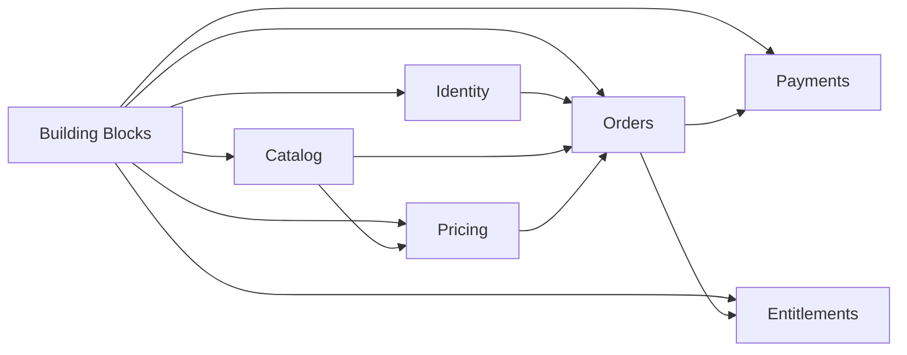

# Roteiro de migração para repositórios independentes

## Escopo atual

Este roteiro cobre somente a separação do projeto atual em repositórios e
aplicações independentes.

Nesta etapa não serão implementados:

- Kubernetes;
- RabbitMQ ou outro broker;
- Saga orientada a eventos;
- Outbox e Inbox;
- service mesh;
- infraestrutura avançada de observabilidade;
- autoscaling.

As integrações iniciais entre APIs serão síncronas por HTTP, protegidas com
tokens técnicos. RabbitMQ e Kubernetes permanecem como evoluções futuras da
arquitetura, mas não bloqueiam a migração.

Este documento complementa:

- [Arquitetura-alvo de microsserviços](target-microservices.md);
- [Autenticação e autorização](target-authentication.md);
- [Building blocks compartilhados](shared-building-blocks.md).

## Objetivo

Criar um repositório Git independente para cada aplicação e um repositório para
o pacote técnico compartilhado.

O sistema atual continuará disponível durante a migração. Um módulo será
extraído, validado e colocado em funcionamento antes que sua implementação
antiga seja removida.

## Repositórios planejados

| Ordem | Repositório | Tipo | Origem |
|---:|---|---|---|
| 1 | `fcg-dotnet-building-blocks` | Biblioteca/NuGet | Building Blocks e recursos técnicos atuais |
| 2 | `fcg-identity-service` | API | Módulo `Identity` |
| 3 | `fcg-catalog-service` | API | Módulo `Catalog` |
| 4 | `fcg-pricing-service` | API | Módulo `Promotions` e preço do Catalog |
| 5 | `fcg-orders-service` | API | Domínio novo para pedidos |
| 6 | `fcg-payments-service` | API | Domínio novo para pagamentos |
| 7 | `fcg-entitlements-service` | API | Módulo `Library` |
| 8 | `fcg-notifications-service` | API ou Worker futuro | Domínio novo e opcional nesta etapa |
| 9 | `fcg-bff` | BFF | Borda para o front-end, quando necessário |
| 10 | `fcg-api-gateway` | Gateway | Borda para clientes externos, posteriormente |

O repositório de Building Blocks é auxiliar. Para comprovar quatro
microsserviços, devem existir pelo menos quatro repositórios de aplicações
executáveis; não é recomendável contar a biblioteca como microsserviço.

## Ordem resumida

| Etapa | Entrega | Resultado |
|---:|---|---|
| 0 | Preparação | Inventário e fronteiras definidos |
| 1 | Building Blocks | Pacote NuGet técnico compartilhado |
| 2 | Padrão de repositório | Estrutura repetível para cada aplicação |
| 3 | Identity | Autenticação em repositório independente |
| 4 | Catalog | Catálogo com banco próprio |
| 5 | Pricing | Preços e promoções separados |
| 6 | Orders | Criação e acompanhamento de pedidos |
| 7 | Payments | Pagamento simulado por HTTP |
| 8 | Entitlements | Biblioteca baseada em direitos adquiridos |
| 9 | Integração da compra | Fluxo síncrono completo e recuperável |
| 10 | Notifications | Notificações sem broker, se entrarem nesta entrega |
| 11 | BFF e Gateway | Borda pública, quando necessária |
| 12 | Desativação do código antigo | Encerramento seguro da migração |



## Regra para considerar um módulo migrado

Um módulo só está migrado quando:

- compila em seu próprio repositório;
- possui solution e pipeline próprios;
- não possui `ProjectReference` para outro repositório;
- possui banco, usuário e migrations próprios;
- não consulta tabelas de outro serviço;
- instala uma versão fixa do `FiapCloudGames.BuildingBlocks`;
- valida tokens técnicos nas rotas internas;
- possui health check e logs correlacionados;
- possui testes unitários e de integração essenciais;
- possui configuração local documentada;
- pode ser iniciado sem o código-fonte do monólito;
- teve seu fluxo validado antes da remoção do módulo antigo.

## Etapa 0 — Preparação

### Atividades

- [ ] registrar o proprietário de cada entidade e tabela;
- [ ] mapear referências entre os módulos atuais;
- [ ] identificar transações que cruzam módulos;
- [ ] listar endpoints públicos e internos;
- [ ] listar configurações e secrets atuais;
- [ ] criar testes de regressão dos fluxos existentes;
- [ ] definir nomes dos repositórios, solutions e bancos;
- [x] definir a organização ou conta Git que receberá os repositórios;
- [x] definir o feed NuGet privado;
- [x] definir o padrão de branches, tags e releases.

### Mapeamento inicial

| Componente atual | Destino |
|---|---|
| `Modules/Identity` | `fcg-identity-service` |
| `Modules/Catalog` | `fcg-catalog-service` |
| `Modules/Promotions` | `fcg-pricing-service` |
| Preço-base no Catalog | `fcg-pricing-service` |
| `Modules/Library` | `fcg-entitlements-service` |
| Aquisição imediata na Library | Orders, Payments e Entitlements |
| API compartilhada | Uma API em cada repositório |
| Migrations compartilhadas | Migrations do serviço proprietário |
| Building Blocks atuais | `fcg-dotnet-building-blocks` após triagem |

## Etapa 1 — Criar o repositório Building Blocks

### Estrutura

```text
fcg-dotnet-building-blocks/
├── FiapCloudGames.BuildingBlocks.sln
├── Directory.Build.props
├── Directory.Packages.props
├── README.md
├── src/
│   └── FiapCloudGames.BuildingBlocks/
└── tests/
    └── FiapCloudGames.BuildingBlocks.Tests/
```

Será publicado um único pacote:

```text
FiapCloudGames.BuildingBlocks
```

### Escopo do primeiro pacote

- `Authentication`;
- `Exceptions`;
- `Hosting`;
- `Observability` básica;
- `Web`;
- health checks;
- correlation ID;
- `ProblemDetails`;
- tratamento comum de exceções.

O módulo `Messaging` não será implementado agora, pois RabbitMQ está fora do
escopo atual.

### Triagem do código atual

| Componente | Decisão inicial |
|---|---|
| `ApiProblemDetails*` | Migrar para `BuildingBlocks.Web` |
| `ApiError` e descritores HTTP | Migrar após retirar dependências específicas |
| `ExceptionHandlingMiddleware` | Evoluir para exception handler comum |
| `ClientErrorLoggingMiddleware` | Migrar para `Web` ou `Observability` |
| `ApiBehaviorOptionsExtensions` | Migrar para `BuildingBlocks.Web` |
| `AppException` e `AppError` | Migrar apenas se permanecerem genéricos |
| `ICurrentUserContext` | Substituir por `ICallerContext` |
| `HttpCurrentUserContext` | Adaptar para chamadores técnicos |
| `IUnitOfWork` | Manter local em cada serviço |
| `DomainRuleViolationException` | Manter local inicialmente |

### Atividades

- [x] criar o repositório Git;
- [x] criar a solution e os projetos;
- [x] mover apenas componentes técnicos aprovados na triagem;
- [x] implementar `AddFiapServiceDefaults`;
- [x] implementar `AddFiapApiDefaults`;
- [x] implementar validação de token técnico;
- [x] implementar `ICallerContext`;
- [x] implementar tratamento com `ProblemDetails`;
- [x] implementar correlation ID;
- [x] criar testes do pacote;
- [x] configurar `dotnet pack`;
- [ ] publicar em um feed NuGet privado;
- [x] documentar instalação e configuração.

### Critério de conclusão

Outro repositório consegue instalar uma versão fixa do pacote e iniciar uma API
com autenticação, erros HTTP, health check e correlação padronizados.

## Etapa 2 — Criar um padrão de repositório

Não será criado um repositório de Kubernetes ou plataforma nesta etapa. Em vez
disso, cada serviço seguirá uma estrutura repetível.

```text
fcg-<nome>-service/
├── FiapCloudGames.<Nome>.sln
├── Directory.Build.props
├── Directory.Packages.props
├── NuGet.Config
├── .env.example
├── README.md
├── src/
│   ├── FiapCloudGames.<Nome>.Api/
│   ├── FiapCloudGames.<Nome>.Application/
│   ├── FiapCloudGames.<Nome>.Domain/
│   └── FiapCloudGames.<Nome>.Infrastructure/
└── tests/
    ├── FiapCloudGames.<Nome>.UnitTests/
    └── FiapCloudGames.<Nome>.IntegrationTests/
```

Workers só serão adicionados quando houver processamento em segundo plano
realmente necessário.

### Atividades

- [ ] definir a versão do .NET;
- [ ] copiar as propriedades comuns de build;
- [ ] configurar o feed do Building Blocks;
- [ ] definir nomes de variáveis de ambiente;
- [ ] padronizar health checks;
- [ ] padronizar endpoints `/api` e `/internal`;
- [ ] definir Dockerfile opcional para execução local;
- [ ] documentar `restore`, `build`, `test` e `run`;
- [ ] criar um template somente depois do segundo serviço, se houver repetição.

## Etapa 3 — Migrar Identity

### Repositório

```text
fcg-identity-service
└── FiapCloudGames.Identity.sln
```

### Atividades

- [ ] copiar somente os projetos e códigos do módulo Identity;
- [ ] remover referências a Catalog, Promotions e Library;
- [ ] criar a API independente;
- [ ] criar banco `fcg_identity`;
- [ ] mover somente as migrations de Identity;
- [ ] migrar os dados de usuários e roles;
- [ ] manter login, cadastro e refresh token;
- [ ] implementar assinatura RSA;
- [ ] publicar a chave pública ou JWKS;
- [ ] cadastrar service clients;
- [ ] implementar Client Credentials;
- [ ] validar cliente, audience e scope;
- [ ] instalar `FiapCloudGames.BuildingBlocks`;
- [ ] criar testes de autenticação e autorização;
- [ ] documentar configuração e secrets.

### Restrição de exposição

O Identity pode ser executado internamente durante a migração. Ele não deve ser
exposto diretamente a clientes externos. Quando a borda pública for criada,
login e cadastro passarão pelo BFF ou API Gateway.

### Critério de conclusão

Identity autentica usuários e aplicações, possui banco próprio e pode ser
executado sem carregar os outros módulos.

## Etapa 4 — Migrar Catalog

### Repositório

```text
fcg-catalog-service
└── FiapCloudGames.Catalog.sln
```

### Atividades

- [ ] copiar somente o módulo Catalog;
- [ ] criar API independente;
- [ ] criar banco `fcg_catalog`;
- [ ] mover migrations e dados de jogos;
- [ ] proteger operações administrativas;
- [ ] remover referências diretas aos outros módulos;
- [ ] instalar Building Blocks;
- [ ] adicionar testes de domínio, API e persistência;
- [ ] manter o preço apenas durante a transição para Pricing.

### Critério de conclusão

Catalog é a fonte de jogos e metadados, possui banco próprio e responde por HTTP
sem utilizar o banco compartilhado.

## Etapa 5 — Migrar Pricing & Promotions

### Repositório

```text
fcg-pricing-service
└── FiapCloudGames.Pricing.sln
```

### Origem

- módulo `Promotions`;
- preço-base atualmente associado ao Catalog;
- regras de desconto e vigência.

### Atividades

- [ ] migrar promoções;
- [ ] mover preço-base para Pricing;
- [ ] definir `Money`, moeda e arredondamento no domínio Pricing;
- [ ] criar banco `fcg_pricing`;
- [ ] criar endpoint interno de cotação;
- [ ] proteger a cotação com token técnico;
- [ ] definir `QuoteId` e validade da cotação;
- [ ] criar testes de vigência, desconto e arredondamento;
- [ ] remover o preço como responsabilidade do Catalog.

### Critério de conclusão

Pricing é a única fonte de preço. Catalog fornece o produto e Pricing fornece a
cotação comercial.

## Etapa 6 — Criar Orders

### Repositório

```text
fcg-orders-service
└── FiapCloudGames.Orders.sln
```

### Atividades

- [ ] modelar `Order` e `OrderItem`;
- [ ] criar banco `fcg_orders`;
- [ ] definir estados e transições permitidas;
- [ ] criar endpoint interno para iniciar pedido;
- [ ] receber `UserId` somente de BFF/Gateway autenticado;
- [ ] consultar Catalog por HTTP;
- [ ] consultar Pricing por HTTP;
- [ ] armazenar snapshot do produto e preço;
- [ ] aceitar uma chave de idempotência;
- [ ] criar consulta de status do pedido;
- [ ] preparar estados para pagamento e entitlement;
- [ ] criar testes de transição e repetição.

### Estados iniciais

```text
PendingPayment
PaymentApproved
PaymentRejected
EntitlementPending
Completed
Failed
Cancelled
```

### Critério de conclusão

Orders cria um pedido idempotente com snapshot comercial sem consultar tabelas
de Catalog ou Pricing.

## Etapa 7 — Criar Payments sem RabbitMQ

### Repositório

```text
fcg-payments-service
└── FiapCloudGames.Payments.sln
```

### Modelo inicial

Orders chamará Payments por HTTP usando token técnico:

```text
client_id = orders-service
audience  = payments-api
scope     = payments.process
```

### Atividades

- [ ] criar API independente;
- [ ] criar banco `fcg_payments`;
- [ ] criar endpoint `/internal/payments`;
- [ ] aceitar `OrderId`, valor, moeda e chave de idempotência;
- [ ] simular aprovação e rejeição;
- [ ] garantir um pagamento efetivo por pedido;
- [ ] proteger o endpoint para permitir Orders;
- [ ] criar endpoint de consulta de status;
- [ ] não armazenar dados completos de cartão;
- [ ] criar testes de aprovação, rejeição e duplicidade.

Payments não deve aceitar processamento normal diretamente do navegador, BFF
ou Gateway.

### Critério de conclusão

Repetir a mesma solicitação não cria uma segunda cobrança e Orders consegue
consultar o resultado após falha de comunicação.

## Etapa 8 — Migrar Library para Entitlements

### Repositório

```text
fcg-entitlements-service
└── FiapCloudGames.Entitlements.sln
```

### Mudança principal

Library deixa de iniciar a compra. Ela passa a representar os direitos que o
usuário já adquiriu.

### Atividades

- [ ] migrar consultas da biblioteca;
- [ ] criar a entidade `Entitlement`;
- [ ] criar banco `fcg_entitlements`;
- [ ] migrar itens existentes da Library;
- [ ] criar endpoint interno para concessão;
- [ ] permitir a concessão apenas para Orders;
- [ ] usar `OrderId` como parte da idempotência;
- [ ] criar endpoint interno de consulta da biblioteca;
- [ ] remover a aquisição imediata da Library;
- [ ] criar testes de propriedade e duplicidade.

### Critério de conclusão

Um direito é concedido uma única vez e a biblioteca pode ser consultada sem
acessar Catalog, Orders ou Payments diretamente.

## Etapa 9 — Integrar o fluxo de compra por HTTP

Sem RabbitMQ, Orders será inicialmente o orquestrador do fluxo.

```text
BFF/Gateway
    -> Orders cria pedido
    -> Orders consulta Catalog
    -> Orders solicita cotação ao Pricing
    -> Orders solicita processamento ao Payments
    -> Orders solicita concessão ao Entitlements
    -> Orders marca pedido como Completed
```

### Regras para tornar o fluxo recuperável

- cada chamada recebe `CorrelationId`;
- criação do pedido exige chave de idempotência;
- Payments é idempotente por `OrderId`;
- Entitlements é idempotente por `OrderId` e `GameId`;
- Orders persiste o estado antes e depois de cada etapa;
- timeouts não são tratados automaticamente como falha definitiva;
- Orders pode consultar Payments após uma resposta desconhecida;
- um endpoint ou job pode retomar pedidos incompletos;
- retries automáticos são usados somente em operações comprovadamente
  idempotentes;
- o JWT do usuário não é repassado entre os serviços.

### Limitação aceita

Essa orquestração HTTP cria maior acoplamento temporal. Ela é aceita para a
primeira migração porque reduz a complexidade. No futuro, o fluxo pode migrar
para eventos sem alterar a propriedade dos domínios.

### Critério de conclusão

O teste ponta a ponta cobre compra aprovada, pagamento rejeitado, repetição da
mesma solicitação e retomada após falha entre Payments e Entitlements.

## Etapa 10 — Notifications opcional

Sem RabbitMQ, Notifications não precisa ser criado antes do fluxo principal.

Se entrar nesta entrega, há duas opções:

1. Orders chama Notifications por HTTP após atualizar seu próprio estado;
2. um job do Notifications consulta uma fila transacional própria ou registros
   pendentes, sem introduzir um broker agora.

A falha de notificação não pode desfazer pagamento, entitlement ou pedido.

### Atividades mínimas

- [ ] criar repositório e aplicação independente;
- [ ] criar endpoint interno autenticado;
- [ ] usar provedor fake ou log para simular envio;
- [ ] aceitar chave de idempotência;
- [ ] registrar tentativas e resultado;
- [ ] permitir retry manual ou por job local.

## Etapa 11 — BFF e API Gateway

BFF e Gateway não precisam bloquear a extração dos módulos, mas são necessários
antes de expor a arquitetura nova externamente.

### BFF

- autentica o usuário;
- mantém tokens do usuário no servidor;
- deriva o `UserId` da sessão;
- chama APIs com token técnico;
- não aceita que o navegador escolha livremente o `UserId`.

### API Gateway

- é a entrada de clientes externos;
- encaminha login e cadastro internamente ao Identity;
- valida o token externo;
- aplica rate limit e políticas de borda;
- não publica endpoints `/internal`.

## Etapa 12 — Desativar o código antigo

### Atividades

- [ ] realizar backup dos dados antigos;
- [ ] bloquear novas escritas no módulo antigo;
- [ ] executar a sincronização final;
- [ ] comparar quantidades e dados críticos;
- [ ] direcionar o fluxo para o novo serviço;
- [ ] monitorar erros e divergências;
- [ ] manter possibilidade de rollback por uma janela definida;
- [ ] remover rotas antigas somente após validação;
- [ ] arquivar o código antigo quando não houver dependências.

## Receita para migrar cada módulo

1. criar o repositório Git;
2. criar a solution e os projetos independentes;
3. configurar `Directory.Build.props` e `Directory.Packages.props`;
4. configurar o feed NuGet privado;
5. instalar uma versão fixa do Building Blocks;
6. copiar somente o código pertencente ao módulo;
7. remover `ProjectReference` para outros módulos;
8. substituir chamadas internas por contratos HTTP;
9. criar banco, usuário e migrations próprios;
10. criar script idempotente de migração de dados;
11. configurar autenticação técnica;
12. configurar health checks, logs e correlation ID;
13. criar testes unitários e de integração;
14. documentar configuração e execução;
15. validar o serviço junto do sistema atual;
16. redirecionar o fluxo;
17. manter rollback durante a estabilização;
18. remover a implementação antiga.

## Estratégia de dados

Cada serviço será o único proprietário de seus dados. Nenhum serviço deve
consultar diretamente tabelas de outro banco.

Para o tamanho atual do projeto, a migração pode usar uma pequena janela de
manutenção:

1. realizar backup;
2. bloquear temporariamente escritas no módulo antigo;
3. executar um script idempotente de cópia e transformação;
4. validar quantidades, chaves e dados críticos;
5. iniciar o novo serviço;
6. redirecionar as chamadas;
7. preservar o banco antigo durante a janela de rollback.

Dual-write deve ser evitado inicialmente porque adiciona problemas de falha
parcial e reconciliação.

## Quatro primeiros repositórios de aplicação

Depois do Building Blocks, os quatro primeiros repositórios executáveis podem
ser:

```text
1. fcg-identity-service
2. fcg-catalog-service
3. fcg-pricing-service
4. fcg-orders-service
```

Essa primeira onda demonstra:

- repositórios independentes;
- autenticação técnica;
- bancos isolados;
- reaproveitamento do NuGet;
- comunicação HTTP entre serviços;
- separação entre produto, preço e pedido.

Payments e Entitlements são adicionados em seguida para concluir a compra.

## Checklist de acompanhamento

| Etapa | Planejada | Em andamento | Concluída |
|---|:---:|:---:|:---:|
| Preparação | [ ] | [ ] | [ ] |
| Building Blocks | [ ] | [ ] | [ ] |
| Padrão de repositório | [ ] | [ ] | [ ] |
| Identity | [ ] | [ ] | [ ] |
| Catalog | [ ] | [ ] | [ ] |
| Pricing | [ ] | [ ] | [ ] |
| Orders | [ ] | [ ] | [ ] |
| Payments | [ ] | [ ] | [ ] |
| Entitlements | [ ] | [ ] | [ ] |
| Integração HTTP da compra | [ ] | [ ] | [ ] |
| Notifications, opcional | [ ] | [ ] | [ ] |
| BFF e API Gateway | [ ] | [ ] | [ ] |
| Desativação do código antigo | [ ] | [ ] | [ ] |

## Evoluções posteriores

Quando a migração por HTTP estiver estável, um novo ciclo pode adicionar:

- RabbitMQ;
- eventos de integração;
- Outbox e Inbox;
- Workers;
- Saga assíncrona;
- Kubernetes;
- NetworkPolicies;
- OpenTelemetry Collector;
- workload identity;
- autoscaling.

Essas evoluções não exigem juntar novamente os repositórios ou os bancos.
