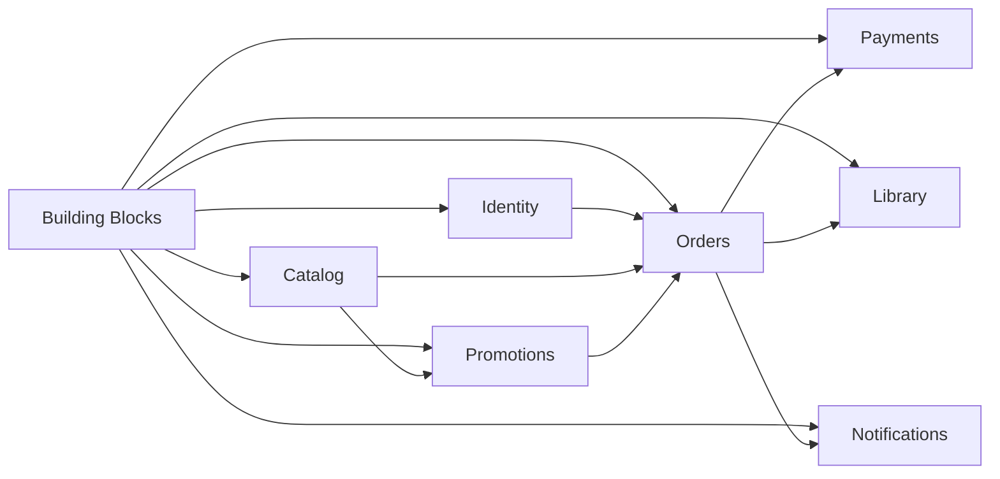

# Roteiro de migração para repositórios independentes

## Escopo fechado

Este roteiro considera somente os seguintes módulos:

1. `Building Blocks`;
2. `Identity`;
3. `Catalog`;
4. `Promotions`;
5. `Library`;
6. `Orders`;
7. `Payments`;
8. `Notifications`.

Não serão criados neste ciclo repositórios separados para Pricing,
Entitlements, BFF, API Gateway, Workers, Kubernetes ou mensageria.

Nesta etapa também não serão implementados:

- Kubernetes;
- RabbitMQ ou outro broker;
- Saga orientada a eventos;
- Outbox e Inbox;
- service mesh;
- infraestrutura avançada de observabilidade;
- autoscaling.

As integrações iniciais entre APIs serão síncronas por HTTP, protegidas com
tokens de serviço. RabbitMQ, Workers, BFF, Gateway e Kubernetes podem ser
avaliados em ciclos posteriores, sem alterar as fronteiras definidas aqui.

Este documento complementa:

- [Arquitetura-alvo de microsserviços](target-microservices.md);
- [Autenticação e autorização](target-authentication.md);
- [Building Blocks compartilhados](shared-building-blocks.md).

## Objetivo

Criar um repositório Git privado para cada aplicação e um repositório privado
para o pacote técnico compartilhado. O monólito será preservado durante a
migração e não receberá as novas implementações.

Um módulo somente será direcionado para a nova aplicação depois que seu
repositório estiver funcional, testado e com banco próprio.

## Responsabilidade de cada módulo

| Módulo | Responsabilidade principal | Não deve fazer |
|---|---|---|
| Building Blocks | Recursos técnicos reutilizáveis | Conter regras de negócio |
| Identity | Usuários, login, roles, clients e emissão de tokens | Conhecer jogos, compras ou pagamentos |
| Catalog | Jogos, metadados e preço-base | Aplicar promoções ou concluir compras |
| Promotions | Campanhas, descontos, vigência e elegibilidade | Ser proprietário do jogo ou do pedido |
| Library | Jogos adquiridos pelo usuário | Iniciar cobrança ou calcular preço |
| Orders | Pedido e orquestração do fluxo de compra | Processar pagamento diretamente |
| Payments | Processamento e estado do pagamento | Conceder jogos na biblioteca |
| Notifications | Registro e envio de notificações | Alterar o resultado da compra |

### Decisões de nomenclatura

- `Promotions` não será renomeado para `Pricing`;
- o preço-base continua pertencendo ao `Catalog`;
- `Promotions` calcula descontos sobre o preço recebido;
- `Library` não será renomeado para `Entitlements`;
- a concessão de um jogo comprado será responsabilidade da `Library`;
- BFF e API Gateway não fazem parte dos oito repositórios deste roteiro.

## Repositórios planejados

| Ordem | Repositório | Tipo | Banco |
|---:|---|---|---|
| 1 | `fcg-dotnet-building-blocks` | Biblioteca/NuGet | Não possui |
| 2 | `fcg-identity-service` | API | `fcg_identity` |
| 3 | `fcg-catalog-service` | API | `fcg_catalog` |
| 4 | `fcg-promotions-service` | API | `fcg_promotions` |
| 5 | `fcg-orders-service` | API | `fcg_orders` |
| 6 | `fcg-payments-service` | API | `fcg_payments` |
| 7 | `fcg-library-service` | API | `fcg_library` |
| 8 | `fcg-notifications-service` | API inicialmente | `fcg_notifications` |

O Building Blocks é uma biblioteca compartilhada e não conta como
microsserviço executável. Os outros sete repositórios são aplicações
independentes.

## Ordem resumida da migração

| Etapa | Entrega | Motivo da ordem |
|---:|---|---|
| 0 | Preparação | Definir fronteiras, contratos e dados |
| 1 | Building Blocks | Fornecer a fundação técnica comum |
| 2 | Padrão de repositório | Evitar estruturas diferentes entre serviços |
| 3 | Identity | Emitir tokens de usuário e de serviço |
| 4 | Catalog | Disponibilizar jogos e preços-base |
| 5 | Promotions | Calcular descontos usando dados do Catalog |
| 6 | Orders | Registrar e controlar o processo de compra |
| 7 | Payments | Processar o pagamento solicitado por Orders |
| 8 | Library | Consultar e conceder jogos comprados |
| 9 | Notifications | Notificar resultados sem controlar a transação |
| 10 | Integração da compra | Validar todo o fluxo síncrono por HTTP |
| 11 | Desativação gradual | Redirecionar tráfego e preservar rollback |



## Regra para considerar um módulo migrado

Um módulo só estará migrado quando:

- compilar em seu próprio repositório;
- possuir solution e pipeline próprios;
- não possuir `ProjectReference` para outro repositório;
- possuir banco, usuário e migrations próprios, quando aplicável;
- não consultar diretamente tabelas de outro serviço;
- instalar uma versão fixa do `FiapCloudGames.BuildingBlocks`;
- validar tokens de serviço nas rotas internas;
- exigir autenticação por padrão e liberar somente rotas explicitamente anônimas;
- possuir health check, logs e correlation ID;
- possuir testes unitários e de integração essenciais;
- possuir configuração local documentada;
- poder ser iniciado sem o código-fonte do monólito;
- ter seu fluxo validado antes do redirecionamento definitivo.

## Etapa 0 — Preparação

### Atividades

- [ ] registrar o proprietário de cada entidade e tabela;
- [ ] mapear referências entre os módulos atuais;
- [ ] identificar transações que cruzam módulos;
- [ ] listar endpoints públicos e internos;
- [ ] definir os contratos HTTP entre serviços;
- [ ] listar configurações e secrets atuais;
- [ ] criar testes de regressão dos fluxos existentes;
- [x] definir os nomes dos repositórios, solutions e bancos;
- [x] definir a organização ou conta Git dos repositórios;
- [x] definir o feed NuGet privado;
- [x] definir o padrão de branches, tags e releases.

### Mapeamento inicial

| Componente atual ou novo | Destino |
|---|---|
| `Modules/Identity` | `fcg-identity-service` |
| `Modules/Catalog` | `fcg-catalog-service` |
| `Modules/Promotions` | `fcg-promotions-service` |
| `Modules/Library` | `fcg-library-service` |
| Pedidos novos | `fcg-orders-service` |
| Pagamentos novos | `fcg-payments-service` |
| Notificações novas | `fcg-notifications-service` |
| Building Blocks atuais | `fcg-dotnet-building-blocks` após triagem |
| Migrations compartilhadas | Repositório do serviço proprietário |

## Etapa 1 — Building Blocks

### Repositório

```text
fcg-dotnet-building-blocks/
├── FiapCloudGames.BuildingBlocks.slnx
├── Directory.Build.props
├── Directory.Packages.props
├── README.md
├── src/
│   └── FiapCloudGames.BuildingBlocks/
└── tests/
    └── FiapCloudGames.BuildingBlocks.Tests/
```

Será mantido inicialmente um único pacote:

```text
FiapCloudGames.BuildingBlocks
```

### Escopo do pacote

- autenticação e autorização comuns;
- tipos de token `user` e `service`;
- `ICallerContext`;
- validação de audience, client, scope e `token_use`;
- autenticação obrigatória por padrão;
- tratamento comum de erros com `ProblemDetails`;
- correlation ID;
- health checks;
- observabilidade básica;
- extensões comuns de hosting e Web API.

Regras de Catalog, Promotions, Orders, Payments, Library ou Notifications não
podem entrar nesse pacote.

### Atividades

- [x] criar o repositório Git;
- [x] criar a solution e os projetos;
- [x] implementar os recursos técnicos aprovados;
- [x] implementar `AddFiapServiceDefaults`;
- [x] implementar `AddFiapApiDefaults`;
- [x] restringir tokens aos tipos `user` e `service`;
- [x] proteger endpoints por padrão com `AllowAnonymous` explícito;
- [x] implementar `ICallerContext`;
- [x] implementar `ProblemDetails` e correlation ID;
- [x] criar testes do pacote;
- [x] configurar `dotnet pack`;
- [ ] publicar a primeira versão no feed NuGet privado;
- [x] documentar instalação e configuração.

## Etapa 2 — Padrão dos repositórios de aplicação

Todos os sete serviços seguirão inicialmente a mesma estrutura:

```text
fcg-<nome>-service/
├── FiapCloudGames.<Nome>.slnx
├── Directory.Build.props
├── Directory.Packages.props
├── NuGet.Config
├── .env.example
├── README.md
├── src/
│   ├── FiapCloudGames.<Nome>.Api/
│   ├── FiapCloudGames.<Nome>.Application/
│   ├── FiapCloudGames.<Nome>.Domain/
│   └── FiapCloudGames.<Nome>.Infrastructure/
└── tests/
    ├── FiapCloudGames.<Nome>.UnitTests/
    └── FiapCloudGames.<Nome>.IntegrationTests/
```

Workers somente serão adicionados futuramente se houver processamento em
segundo plano que justifique uma aplicação separada.

## Etapa 3 — Identity

```text
fcg-identity-service
└── FiapCloudGames.Identity.slnx
```

### Atividades

- [ ] copiar somente os códigos pertencentes ao Identity;
- [ ] remover referências aos demais módulos;
- [ ] criar banco `fcg_identity` e migrations próprias;
- [ ] migrar usuários, credenciais e roles;
- [ ] manter login, cadastro e refresh token;
- [ ] implementar assinatura assimétrica e JWKS;
- [ ] cadastrar um `client_id` e segredo para cada aplicação;
- [ ] implementar Client Credentials;
- [ ] emitir `token_use=user` para usuários;
- [ ] emitir `token_use=service` para aplicações;
- [ ] garantir `sub == client_id` em tokens de serviço;
- [ ] emitir audiences e scopes específicos;
- [ ] instalar o Building Blocks;
- [ ] criar testes de autenticação e autorização.

## Etapa 4 — Catalog

```text
fcg-catalog-service
└── FiapCloudGames.Catalog.slnx
```

Catalog será a fonte de jogos, metadados e preço-base. Promoções e descontos
não serão persistidos no banco do Catalog.

### Atividades

- [ ] copiar somente o módulo Catalog;
- [ ] criar API, banco `fcg_catalog` e migrations próprias;
- [ ] migrar jogos, metadados e preços-base;
- [ ] proteger operações administrativas;
- [ ] criar endpoint interno de consulta para Orders;
- [ ] remover referências diretas aos demais módulos;
- [ ] instalar o Building Blocks;
- [ ] adicionar testes de domínio, API e persistência.

## Etapa 5 — Promotions

```text
fcg-promotions-service
└── FiapCloudGames.Promotions.slnx
```

Promotions será responsável pelas campanhas, descontos, períodos de vigência
e elegibilidade. Receberá o preço-base na solicitação e devolverá o desconto e
o preço final calculado.

### Atividades

- [ ] copiar somente o módulo Promotions;
- [ ] criar API, banco `fcg_promotions` e migrations próprias;
- [ ] migrar promoções e regras de vigência;
- [ ] criar endpoint interno de cálculo de promoção;
- [ ] receber `GameId`, preço-base, moeda e contexto necessário;
- [ ] devolver promoção aplicada, desconto e preço final;
- [ ] não consultar diretamente o banco do Catalog;
- [ ] criar testes de vigência, elegibilidade e arredondamento.

## Etapa 6 — Orders

```text
fcg-orders-service
└── FiapCloudGames.Orders.slnx
```

Orders registra o pedido, armazena o snapshot comercial e orquestra o fluxo de
compra por HTTP.

### Atividades

- [ ] modelar `Order` e `OrderItem`;
- [ ] criar banco `fcg_orders` e migrations próprias;
- [ ] definir estados e transições permitidas;
- [ ] receber o `UserId` pelo contrato do endpoint interno;
- [ ] aceitar chave de idempotência;
- [ ] consultar Catalog para produto e preço-base;
- [ ] consultar Promotions para desconto e preço final;
- [ ] persistir o snapshot utilizado na compra;
- [ ] solicitar o processamento ao Payments;
- [ ] solicitar a concessão do jogo à Library após aprovação;
- [ ] solicitar a notificação sem depender dela para concluir o pedido;
- [ ] criar consulta de status e retomada de pedidos incompletos;
- [ ] criar testes de transições, falhas e idempotência.

### Estados iniciais

```text
PendingPayment
PaymentApproved
PaymentRejected
LibraryPending
Completed
Failed
Cancelled
```

## Etapa 7 — Payments

```text
fcg-payments-service
└── FiapCloudGames.Payments.slnx
```

Orders chamará Payments por HTTP com token de serviço:

```text
client_id = orders-api
audience  = payments-api
scope     = payments.process
```

### Atividades

- [ ] criar API, banco `fcg_payments` e migrations próprias;
- [ ] criar endpoint `/internal/payments`;
- [ ] aceitar `OrderId`, valor, moeda e chave de idempotência;
- [ ] simular aprovação e rejeição;
- [ ] garantir um pagamento efetivo por pedido;
- [ ] autorizar somente os clients necessários;
- [ ] criar endpoint de consulta de status;
- [ ] não armazenar dados completos de cartão;
- [ ] criar testes de aprovação, rejeição e duplicidade.

Payments não deve aceitar o processamento normal diretamente de um cliente
externo.

## Etapa 8 — Library

```text
fcg-library-service
└── FiapCloudGames.Library.slnx
```

Library representa os jogos que o usuário possui. Ela permite consultar a
biblioteca e recebe de Orders a concessão de jogos comprados.

### Atividades

- [ ] copiar somente o módulo Library;
- [ ] criar API, banco `fcg_library` e migrations próprias;
- [ ] migrar os itens existentes da biblioteca;
- [ ] criar endpoint interno idempotente para conceder um jogo;
- [ ] permitir concessões somente para clients autorizados;
- [ ] usar `OrderId`, `UserId` e `GameId` na proteção contra duplicidade;
- [ ] criar endpoint interno para consultar a biblioteca do usuário;
- [ ] remover da Library a responsabilidade de iniciar a compra;
- [ ] criar testes de propriedade, consulta e duplicidade.

## Etapa 9 — Notifications

```text
fcg-notifications-service
└── FiapCloudGames.Notifications.slnx
```

Notifications será inicialmente uma API interna. Orders poderá solicitar uma
notificação após persistir a mudança de estado. Uma falha de notificação não
pode desfazer pagamento, concessão na Library ou pedido.

### Atividades

- [ ] criar API, banco `fcg_notifications` e migrations próprias;
- [ ] criar endpoint interno autenticado;
- [ ] usar provedor fake ou log para simular o envio;
- [ ] registrar destinatário, template, canal, tentativa e resultado;
- [ ] não persistir secrets ou tokens na mensagem;
- [ ] aceitar chave de idempotência;
- [ ] permitir retry manual inicialmente;
- [ ] criar testes de registro, envio, falha e duplicidade.

Um Worker e um broker poderão ser adicionados futuramente sem mudar a
responsabilidade do módulo.

## Etapa 10 — Integração da compra por HTTP

Sem RabbitMQ, Orders será o orquestrador inicial:

```text
Ponta autenticada
    -> Orders cria o pedido com o UserId recebido no contrato interno
    -> Orders consulta o jogo e o preço-base no Catalog
    -> Orders calcula o desconto no Promotions
    -> Orders grava o snapshot comercial
    -> Orders solicita o pagamento ao Payments
    -> Orders concede o jogo na Library
    -> Orders marca o pedido como Completed
    -> Orders solicita a notificação ao Notifications
```

### Regras de recuperação

- toda chamada recebe `CorrelationId`;
- criação do pedido exige chave de idempotência;
- Payments é idempotente por `OrderId`;
- Library é idempotente por `OrderId`, `UserId` e `GameId`;
- Notifications é idempotente pela chave fornecida por Orders;
- Orders persiste o estado antes e depois de cada etapa;
- timeout não é tratado automaticamente como falha definitiva;
- Orders pode consultar Payments após uma resposta desconhecida;
- um endpoint administrativo pode retomar pedidos incompletos;
- retries automáticos somente ocorrem em operações idempotentes;
- o token do usuário nunca é repassado entre os serviços.

### Critério de conclusão

O teste ponta a ponta cobre compra aprovada, pagamento rejeitado, promoção
válida e expirada, repetição da mesma solicitação, falha de notificação e
retomada após falha entre Payments e Library.

## Etapa 11 — Desativação gradual do código antigo

- [ ] realizar backup dos dados antigos;
- [ ] bloquear novas escritas no módulo antigo durante o corte;
- [ ] executar a sincronização final;
- [ ] comparar quantidades e dados críticos;
- [ ] direcionar o fluxo para o novo serviço;
- [ ] monitorar erros e divergências;
- [ ] manter rollback por uma janela definida;
- [ ] remover rotas antigas somente após validação;
- [ ] arquivar o código antigo quando não houver dependências.

## Receita para migrar cada módulo

1. criar o repositório Git privado;
2. criar a solution e os projetos independentes;
3. configurar propriedades de build e dependências;
4. configurar o feed NuGet privado;
5. instalar uma versão fixa do Building Blocks;
6. copiar somente o código pertencente ao módulo;
7. remover `ProjectReference` para outros módulos;
8. substituir dependências entre módulos por contratos HTTP;
9. criar banco, usuário e migrations próprios;
10. criar script idempotente de migração de dados;
11. configurar autenticação e autorização;
12. configurar health checks, logs e correlation ID;
13. criar testes unitários e de integração;
14. documentar configuração e execução;
15. validar o serviço junto do sistema atual;
16. redirecionar o fluxo;
17. manter rollback durante a estabilização;
18. retirar a implementação antiga somente ao final.

## Estratégia de dados

Cada serviço será o único proprietário de seus dados. Nenhum serviço deve
consultar diretamente tabelas de outro banco.

Para a primeira migração, pode ser usada uma janela curta de manutenção:

1. realizar backup;
2. bloquear temporariamente escritas no módulo antigo;
3. executar um script idempotente de cópia e transformação;
4. validar quantidades, chaves e dados críticos;
5. iniciar o novo serviço;
6. redirecionar as chamadas;
7. preservar o banco antigo durante a janela de rollback.

Dual-write deve ser evitado inicialmente porque adiciona falhas parciais e
necessidade de reconciliação.

## Quatro primeiros repositórios de aplicação

Depois do Building Blocks, os quatro primeiros repositórios executáveis serão:

```text
1. fcg-identity-service
2. fcg-catalog-service
3. fcg-promotions-service
4. fcg-orders-service
```

Essa primeira onda comprova quatro aplicações independentes, autenticação
entre serviços, bancos isolados, reutilização do NuGet e comunicação HTTP.
Payments, Library e Notifications completam o fluxo na onda seguinte.

## Checklist de acompanhamento

| Etapa | Planejada | Em andamento | Concluída |
|---|:---:|:---:|:---:|
| Preparação | [ ] | [ ] | [ ] |
| Building Blocks | [ ] | [ ] | [x] |
| Padrão de repositório | [x] | [ ] | [ ] |
| Identity | [x] | [ ] | [ ] |
| Catalog | [x] | [ ] | [ ] |
| Promotions | [x] | [ ] | [ ] |
| Orders | [x] | [ ] | [ ] |
| Payments | [x] | [ ] | [ ] |
| Library | [x] | [ ] | [ ] |
| Notifications | [x] | [ ] | [ ] |
| Integração HTTP da compra | [x] | [ ] | [ ] |
| Desativação gradual | [x] | [ ] | [ ] |

## Evoluções posteriores fora deste roteiro

Depois que a migração síncrona estiver estável, um novo ciclo poderá avaliar:

- BFF e API Gateway;
- RabbitMQ e eventos de integração;
- Outbox e Inbox;
- Workers e Saga assíncrona;
- Kubernetes;
- OpenTelemetry Collector;
- workload identity;
- autoscaling.

Essas evoluções não criam novos módulos de domínio e não exigem juntar
novamente os repositórios ou bancos definidos neste roteiro.
