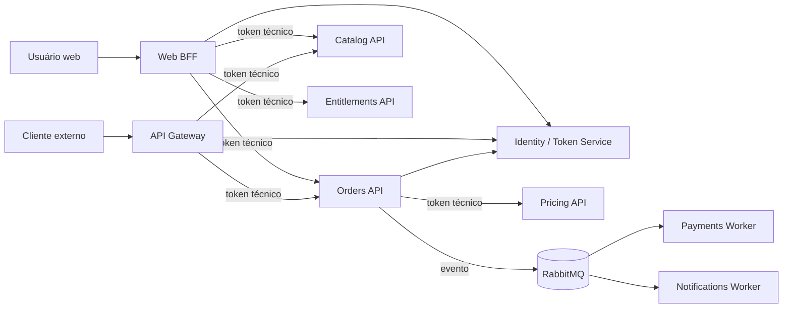
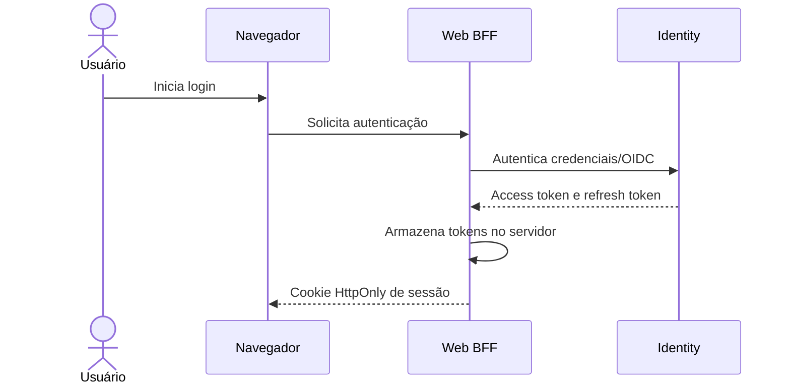
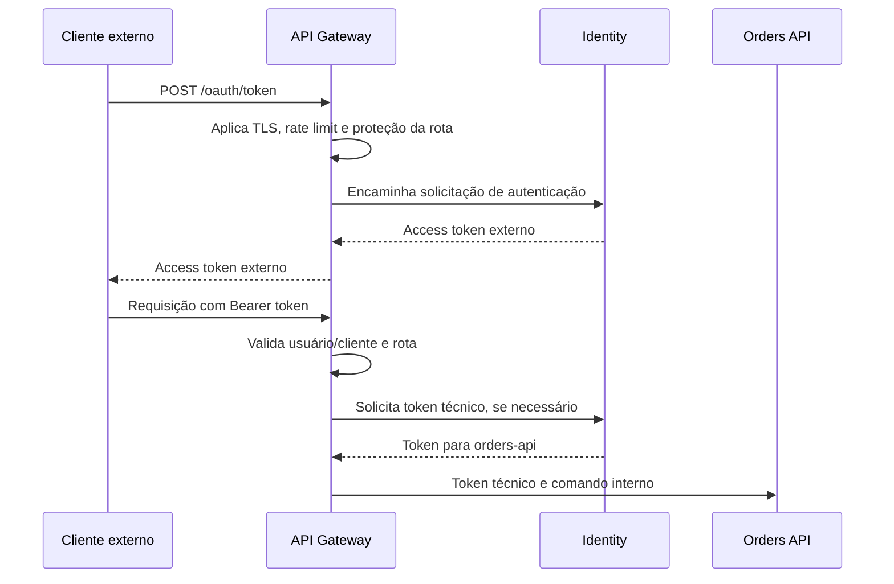
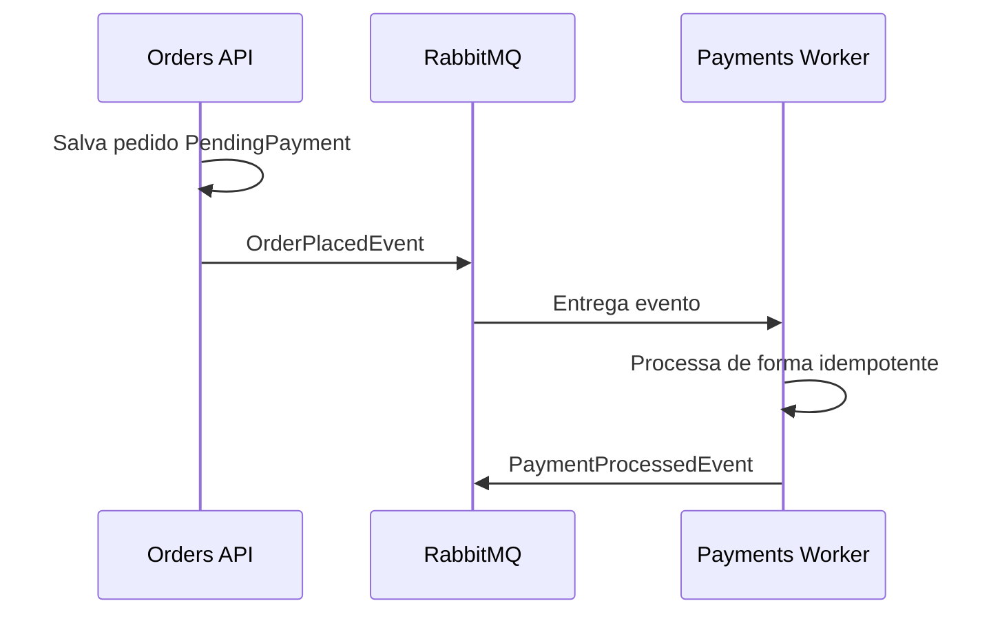

# Arquitetura-alvo de autenticação e autorização

## Status deste documento

Este documento descreve o modelo de autenticação e autorização planejado para
a arquitetura de microsserviços. Ele não representa integralmente o estado
atual do monólito.

A primeira etapa da migração utilizará chamadas HTTP entre serviços. RabbitMQ,
Workers e Kubernetes descritos neste documento representam a evolução futura e
não são pré-requisitos para separar os repositórios.

O comportamento atualmente implementado está documentado em
[Autenticação e autorização atual](../development/authentication-authorization.md).
A decomposição planejada dos serviços está em
[Arquitetura-alvo de microsserviços](target-microservices.md).

## Objetivo

Permitir que novos integrantes entendam:

- onde o usuário faz login;
- onde o token do usuário é armazenado e validado;
- como BFF e API Gateway chamam as APIs internas;
- como os microsserviços se autenticam entre si;
- quando o `UserId` precisa ser propagado;
- como proteger chamadas HTTP e eventos do RabbitMQ;
- quais responsabilidades pertencem ao Identity e a cada API.

## Resumo executivo

O sistema adotará autenticação de usuário na borda e autenticação de aplicação
na rede interna.

```text
Usuário web
    -> BFF valida sessão do usuário
    -> BFF chama APIs com token técnico

Cliente externo
    -> API Gateway valida o token externo
    -> Gateway chama APIs com token técnico

Microsserviço
    -> solicita token técnico ao Identity
    -> chama outro microsserviço

Worker
    -> autentica no RabbitMQ com credencial própria
    -> não recebe o JWT original do usuário
```

Regras centrais:

1. Somente o Identity emite tokens.
2. BFF e Gateway validam a identidade do usuário na borda.
3. APIs internas validam tokens técnicos, não necessariamente o JWT original
   do usuário.
4. Cada aplicação possui `client_id`, credencial e permissões próprias.
5. O `client_secret` é enviado somente ao Identity.
6. APIs de destino recebem apenas access tokens assinados.
7. O `UserId` é propagado somente quando necessário para o negócio.
8. APIs internas nunca confiam em um `UserId` sem antes autenticar a aplicação
   que o enviou.
9. Regras de negócio permanecem nos microsserviços.
10. Eventos não transportam o JWT do usuário.

## Componentes e fronteiras de confiança



### Borda pública

Podem ser expostos externamente:

- Web BFF;
- API Gateway;
- endpoints explicitamente públicos, por decisão arquitetural.

O Identity não é exposto diretamente. Para clientes externos, cadastro, login,
renovação e emissão de token também entram pelo API Gateway, que encaminha a
requisição ao Identity pela rede interna.

### Rede interna

Devem permanecer internos:

- Identity;
- Catalog API;
- Pricing API;
- Orders API;
- Payments API e Worker;
- Entitlements API e Worker;
- Notifications API e Worker;
- RabbitMQ;
- PostgreSQL.

No Kubernetes, APIs internas devem usar `ClusterIP`. NetworkPolicies devem
limitar quais workloads podem chamar cada serviço.

## Autenticação versus autorização

### Autenticação

Responde quem está chamando:

```text
Usuário: user-123
Aplicação: web-bff
Serviço: orders-service
Worker: payments-worker
```

### Autorização técnica

Responde quais operações o chamador pode solicitar:

```text
web-bff pode criar pedidos?
orders-service pode solicitar uma cotação?
orders-service pode iniciar um pagamento?
payments-worker pode publicar o resultado do pagamento?
```

### Autorização de negócio

Responde se a operação faz sentido para o recurso específico:

```text
O pedido pertence ao usuário?
O jogo está disponível?
O valor da cotação ainda é válido?
O pagamento já foi processado?
O usuário já possui o entitlement?
```

BFF e Gateway podem aplicar autorização inicial. Eles não substituem as regras
de negócio das APIs internas.

## Identidades técnicas

Cada aplicação é registrada no Identity como um cliente confidencial.

| Aplicação | `client_id` sugerido |
|---|---|
| Web BFF | `web-bff` |
| API Gateway | `public-api-gateway` |
| Catalog | `catalog-service` |
| Pricing | `pricing-service` |
| Orders | `orders-service` |
| Payments API | `payments-service` |
| Payments Worker | `payments-worker` |
| Entitlements API | `entitlements-service` |
| Entitlements Worker | `entitlements-worker` |
| Notifications Worker | `notifications-worker` |

O `client_id` identifica o chamador, não a API de destino.

Exemplo:

```text
Orders chama Payments

client_id = orders-service
audience  = payments-api
scope     = payments.process
```

## Responsabilidades do Identity

O Identity será a única autoridade emissora de tokens.

Responsabilidades:

- cadastrar e autenticar usuários;
- manter credenciais e sessões;
- emitir e renovar tokens de usuário;
- registrar clientes técnicos;
- validar `client_id` e `client_secret`;
- emitir tokens por Client Credentials;
- controlar audiences e scopes permitidos por cliente;
- assinar tokens com chave privada;
- publicar a chave pública ou JWKS;
- revogar credenciais técnicas comprometidas;
- auditar emissão e falhas de autenticação.

O Identity não deve:

- decidir se um pedido pode mudar de estado;
- decidir se um pagamento pode ser processado;
- consultar bancos de outros serviços;
- criar entitlements;
- concentrar regras de negócio dos microsserviços.

## Dados do Identity

Tabelas sugeridas:

```text
users
roles
user_roles
refresh_tokens
service_clients
service_client_secrets
service_client_scopes
service_client_audiences
signing_keys
outbox_messages
```

### Service client

```text
Id
ClientId
DisplayName
Status
CreatedAtUtc
UpdatedAtUtc
```

### Service client secret

```text
Id
ServiceClientId
SecretHash
CreatedAtUtc
ExpiresAtUtc
RevokedAtUtc
```

O secret deve ser armazenado como hash. O valor original só é apresentado na
criação ou rotação.

## Tipos de credencial

### Sessão do BFF

O navegador recebe apenas um cookie de sessão:

```text
HttpOnly
Secure
SameSite
```

O BFF mantém os tokens do usuário no servidor. O navegador não armazena access
token em `localStorage`.

### Token externo

Clientes externos apresentam um access token ao API Gateway:

```http
Authorization: Bearer <token-externo>
```

O Gateway valida assinatura, emissor, audience, expiração e permissões.

### Token técnico

É usado entre aplicações internas. Não precisa representar um usuário.

Exemplo:

```json
{
  "iss": "fiap-cloud-games-identity",
  "sub": "orders-service",
  "client_id": "orders-service",
  "aud": "payments-api",
  "scope": [
    "payments.process"
  ],
  "jti": "966610d6-b290-4e68-a867-f343203c9569",
  "iat": 1789938000,
  "exp": 1789938300
}
```

Esse token não contém nome, e-mail ou papel do usuário.

### Token delegado

É uma evolução para operações em que a API interna precisa verificar
criptograficamente a identidade do usuário e do intermediário.

```json
{
  "sub": "user-123",
  "act": {
    "sub": "web-bff"
  },
  "aud": "orders-api",
  "scope": [
    "orders.create"
  ]
}
```

Na primeira versão será usado o padrão Trusted Subsystem: o BFF/Gateway envia o
`UserId` no comando interno e a API confia nele após autenticar o chamador.

## Chaves de assinatura

Deve ser usada assinatura assimétrica:

```text
Identity
  -> guarda chave privada
  -> assina tokens

APIs internas
  -> recebem chave pública
  -> validam tokens
  -> não conseguem emitir tokens válidos
```

A chave privada fica em Secret ou cofre. A chave pública pode ser entregue por
ConfigMap ou publicada pelo Identity em JWKS.

## Fluxo 1: login pelo BFF



Depois do login, o navegador envia apenas o cookie ao BFF.

## Fluxo 2: cliente externo pelo Gateway



O endereço do Identity é conhecido pelo Gateway e pelos serviços internos, mas
não é publicado para a internet. O cliente externo conhece apenas o endereço do
Gateway, por exemplo:

```text
POST https://api.fiapcloudgames.com/oauth/token
POST https://api.fiapcloudgames.com/users
POST https://api.fiapcloudgames.com/orders
```

O Gateway pode rotear internamente:

```text
/oauth/* -> identity-api
/users/* -> identity-api
/orders/* -> orders-api ou adaptação interna do Gateway
```

As rotas de login e emissão de token não exigem um token prévio, mas devem ter
TLS, rate limiting, proteção contra abuso, validação de payload e auditoria.

## Fluxo 3: BFF cria um pedido

O contrato público não aceita `UserId`.

```http
POST /orders
Cookie: session=<cookie>
Content-Type: application/json

{
  "gameId": "80fdc742-e7c1-4564-a269-8d52784bec44"
}
```

O BFF obtém o usuário pela sessão:

```csharp
var userId = session.GetRequiredUserId();
```

O BFF solicita ao Identity um token técnico:

```text
client_id = web-bff
audience  = orders-api
scope     = orders.create
```

Depois chama o endpoint interno:

```http
POST /internal/orders
Authorization: Bearer <token-tecnico-do-bff>
Content-Type: application/json

{
  "userId": "47de4c37-34ab-4084-a293-e46229c34aad",
  "gameId": "80fdc742-e7c1-4564-a269-8d52784bec44"
}
```

Orders confia no `UserId` porque confirmou que o chamador é o `web-bff` e que
ele possui o scope `orders.create`.

## Contratos público e interno

Não reutilize o mesmo DTO nos dois lados.

### Contrato público do BFF

```csharp
public sealed record CreateOrderRequest(
    Guid GameId);
```

### Contrato interno do Orders

```csharp
public sealed record CreateInternalOrderRequest(
    Guid UserId,
    Guid GameId);
```

O BFF ignora qualquer tentativa do navegador de informar outro usuário.

```csharp
var internalRequest = new CreateInternalOrderRequest(
    UserId: session.GetRequiredUserId(),
    GameId: request.GameId);
```

## Fluxo 4: Orders chama Pricing

Orders precisa de uma cotação síncrona para criar o snapshot do pedido.

```text
client_id = orders-service
audience  = pricing-api
scope     = pricing.quote
```

Requisição:

```http
POST /internal/quotes
Authorization: Bearer <token-tecnico-orders>
Content-Type: application/json

{
  "gameId": "80fdc742-e7c1-4564-a269-8d52784bec44",
  "region": "BR",
  "currency": "BRL"
}
```

Pricing não precisa receber o JWT original do usuário. Se existir preço
personalizado, o comando pode conter somente os atributos comerciais
necessários e permitidos.

## Fluxo 5: Orders inicia o pagamento

O fluxo preferencial é assíncrono:



O evento contém dados de negócio e auditoria, não o JWT do usuário:

```json
{
  "eventId": "9d9ef2c2-737d-4898-8cfa-60d566a12f98",
  "correlationId": "8bdce683-5144-4d93-8e43-8908372ec822",
  "orderId": "585e4649-a9bb-4635-ab61-1424983d19d4",
  "userId": "47de4c37-34ab-4084-a293-e46229c34aad",
  "amount": 79.90,
  "currency": "BRL"
}
```

O `UserId` é contexto de negócio/auditoria. A autenticação do Worker ocorre por
credenciais e permissões do RabbitMQ.

Se for necessária chamada HTTP síncrona:

```text
client_id = orders-service
audience  = payments-api
scope     = payments.process
```

Payments não deve aceitar `payments.process` diretamente de `web-bff` ou
`public-api-gateway`.

## Fluxo 6: consulta da Library

O navegador solicita a própria biblioteca:

```http
GET /library
Cookie: session=<cookie>
```

O BFF obtém o `UserId` da sessão e chama Entitlements:

```http
GET /internal/users/47de4c37-34ab-4084-a293-e46229c34aad/library
Authorization: Bearer <token-tecnico-do-bff>
```

Token esperado:

```text
client_id = web-bff
audience  = entitlements-api
scope     = entitlements.read
```

O usuário nunca escolhe livremente o `UserId` enviado nessa chamada.

## Client Credentials

### Solicitação

```http
POST /connect/token
Content-Type: application/x-www-form-urlencoded

grant_type=client_credentials
&client_id=orders-service
&client_secret=<secret>
&audience=payments-api
&scope=payments.process
```

### Resposta

```json
{
  "access_token": "eyJhbGciOiJSUzI1NiIs...",
  "token_type": "Bearer",
  "expires_in": 300
}
```

O token técnico deve ser curto e armazenado em cache pelo cliente até próximo
da expiração. Não solicite um novo token para cada chamada.

## Validação em uma API ASP.NET Core

Exemplo do Payments:

```csharp
builder.Services
    .AddAuthentication(
        JwtBearerDefaults.AuthenticationScheme)
    .AddJwtBearer(options =>
    {
        options.MapInboundClaims = false;

        options.TokenValidationParameters =
            new TokenValidationParameters
            {
                ValidateIssuer = true,
                ValidIssuer = "fiap-cloud-games-identity",

                ValidateAudience = true,
                ValidAudience = "payments-api",

                ValidateLifetime = true,
                ValidateIssuerSigningKey = true,
                IssuerSigningKey = publicKey,

                ClockSkew = TimeSpan.FromSeconds(30)
            };
    });
```

Policy:

```csharp
builder.Services.AddAuthorization(options =>
{
    options.AddPolicy(
        "ProcessPayments",
        policy =>
        {
            policy.RequireAuthenticatedUser();
            policy.RequireClaim(
                "client_id",
                "orders-service");
            policy.RequireClaim(
                "scope",
                "payments.process");
        });
});
```

Endpoint:

```csharp
[Authorize(Policy = "ProcessPayments")]
[HttpPost("/internal/payments")]
public async Task<ActionResult<PaymentResponse>> Process(
    [FromBody] ProcessPaymentRequest request,
    [FromServices] ProcessPaymentService service,
    CancellationToken cancellationToken)
{
    var result = await service.ExecuteAsync(
        request,
        cancellationToken);

    return Ok(result);
}
```

## Obtenção de token por um serviço

```csharp
public sealed record TokenResponse(
    [property: JsonPropertyName("access_token")]
    string AccessToken,

    [property: JsonPropertyName("token_type")]
    string TokenType,

    [property: JsonPropertyName("expires_in")]
    int ExpiresIn);
```

```csharp
public sealed class ServiceTokenProvider(
    HttpClient identityClient,
    IConfiguration configuration)
{
    public async Task<string> GetTokenAsync(
        string audience,
        string scope,
        CancellationToken cancellationToken)
    {
        var content = new FormUrlEncodedContent(
            new Dictionary<string, string>
            {
                ["grant_type"] = "client_credentials",
                ["client_id"] = configuration[
                    "ServiceAuthentication:ClientId"]!,
                ["client_secret"] = configuration[
                    "ServiceAuthentication:ClientSecret"]!,
                ["audience"] = audience,
                ["scope"] = scope
            });

        using var response = await identityClient.PostAsync(
            "connect/token",
            content,
            cancellationToken);

        response.EnsureSuccessStatusCode();

        var token = await response.Content
            .ReadFromJsonAsync<TokenResponse>(
                cancellationToken);

        return token!.AccessToken;
    }
}
```

Na implementação real, envolva o provider com cache e renovação antecipada.

## Catálogo de permissões inicial

| Chamador | Destino | Audience | Scope |
|---|---|---|---|
| `web-bff` | Orders | `orders-api` | `orders.create`, `orders.read` |
| `web-bff` | Catalog | `catalog-api` | `catalog.read` |
| `web-bff` | Entitlements | `entitlements-api` | `entitlements.read` |
| `public-api-gateway` | Orders | `orders-api` | `orders.create`, `orders.read` |
| `orders-service` | Catalog | `catalog-api` | `catalog.read` |
| `orders-service` | Pricing | `pricing-api` | `pricing.quote` |
| `orders-service` | Payments | `payments-api` | `payments.process` |
| `orders-service` | Entitlements | `entitlements-api` | `entitlements.grant` |
| `support-bff` | Payments | `payments-api` | `payments.read`, `payments.refund` |

O Identity deve rejeitar combinações não cadastradas de cliente, audience e
scope.

## Endpoints públicos e internos

Convenção sugerida:

```text
/api/*       contratos externos
/internal/*  contratos entre aplicações
```

Exemplos:

```text
POST /api/auth/login
POST /api/users

POST /internal/orders
POST /internal/quotes
POST /internal/payments
GET  /internal/users/{userId}/library
```

Endpoints internos exigem token técnico e não devem ser publicados pelo
Gateway, exceto quando houver decisão explícita.

## Módulo compartilhado de autenticação

As funcionalidades comuns de autenticação ficarão no namespace:

```text
FiapCloudGames.BuildingBlocks.Authentication
```

Esse namespace fará parte do pacote único
`FiapCloudGames.BuildingBlocks`, conforme a decisão descrita em
[Building blocks compartilhados entre microsserviços](shared-building-blocks.md).

Responsabilidades permitidas:

- configurar JWT Bearer;
- validar issuer e chave pública;
- extrair `client_id` e scopes;
- registrar policies técnicas;
- obter e armazenar em cache tokens técnicos;
- padronizar respostas 401 e 403.

Não deve conter:

- entidade `User`;
- `IdentityDbContext`;
- hash de senha;
- geração de token;
- policies específicas de negócio;
- autorização de pedidos, pagamentos ou entitlements.

## Configuração

### ConfigMap

```text
Authentication__Issuer=fiap-cloud-games-identity
Authentication__Audience=payments-api
Authentication__Authority=http://identity-api
ServiceAuthentication__ClientId=payments-service
```

### Secret

```text
ServiceAuthentication__ClientSecret=<secret>
Authentication__PrivateKey=<somente-no-identity>
RabbitMq__Password=<secret>
```

A chave pública não é segredo. A chave privada nunca sai do Identity.

## RabbitMQ

Cada Worker possui usuário e permissões próprias no broker.

```text
orders-publisher
payments-worker
entitlements-worker
notifications-worker
```

Exemplo de autorização:

```text
payments-worker
  pode consumir: orders.order-placed.payments
  pode publicar: payments.payment-processed
  não pode consumir: identity.user-created.notifications
  não pode publicar: entitlements.entitlement-granted
```

Mensagens carregam:

- `EventId`;
- `CorrelationId`;
- `CausationId`;
- identificadores de negócio;
- `UserId` apenas quando necessário;
- data e versão do evento.

Mensagens não carregam:

- JWT do usuário;
- client secret;
- senha;
- chave privada;
- dados completos de cartão.

## Respostas de segurança

### 401 Unauthorized

Usar quando:

- token está ausente;
- assinatura é inválida;
- token expirou;
- issuer ou audience não são aceitos;
- cliente foi revogado.

### 403 Forbidden

Usar quando:

- token é válido;
- chamador foi autenticado;
- scope ou policy não permite a operação.

### 404 Not Found

Pode ser usado quando revelar a existência do recurso representaria risco. A
decisão deve ser consistente em cada API.

## Auditoria e logs

Registrar em operações sensíveis:

```text
TraceId
CorrelationId
ClientId
UserId, quando aplicável
Scope utilizado
Audience
OrderId, PaymentId ou EntitlementId
Resultado
Horário UTC
```

Não registrar:

- access token completo;
- refresh token;
- client secret;
- senha;
- chave privada;
- código de segurança de cartão.

## Riscos do Trusted Subsystem

Como Orders confia no `UserId` informado pelo BFF, um BFF comprometido pode
tentar agir em nome de outro usuário.

Mitigações da primeira versão:

- BFF isolado e com secret exclusivo;
- scopes mínimos;
- APIs internas inacessíveis externamente;
- TLS;
- NetworkPolicies;
- auditoria de `ClientId` e `UserId`;
- rotação de secrets;
- token técnico curto;
- endpoints internos separados;
- proibição de BFF chamar Payments diretamente.

Evoluções:

- OAuth Token Exchange;
- token delegado com claims `sub` e `act`;
- mTLS entre workloads;
- workload identity;
- secrets substituídos por certificados curtos;
- policy engine para autorizações complexas.

## Testes obrigatórios

### Identity

- rejeita client secret inválido;
- rejeita cliente revogado;
- rejeita audience não cadastrada;
- rejeita scope não permitido;
- emite token com expiração curta;
- não inclui claims de usuário em token técnico;
- aceita rotação de secret sem interromper o cliente;
- assina com a chave privada esperada.

### APIs internas

- rejeitam requisição sem token;
- rejeitam issuer incorreto;
- rejeitam audience incorreta;
- rejeitam token expirado;
- rejeitam scope ausente;
- rejeitam `client_id` não autorizado;
- aceitam apenas combinações explicitamente permitidas;
- não confiam em `UserId` vindo de cliente não autorizado.

### BFF/Gateway

- não aceitam `UserId` informado livremente pelo navegador;
- usam o usuário da sessão/token validado;
- não expõem o token técnico ao cliente;
- não registram secrets em logs;
- renovam tokens técnicos antes da expiração;
- removem headers internos recebidos externamente.

### RabbitMQ

- Worker não consome fila sem permissão;
- eventos duplicados não duplicam operações;
- evento inválido é rejeitado ou enviado para dead-letter queue;
- dados sensíveis não aparecem na mensagem.

## Checklist para adicionar uma nova API

1. Registrar um `client_id` exclusivo no Identity.
2. Gerar um client secret e armazenar apenas seu hash no Identity.
3. Guardar o valor do secret em Kubernetes Secret.
4. Definir a audience da API.
5. Definir os scopes de entrada e saída.
6. Registrar quais clientes podem solicitar cada scope.
7. Configurar JWT Bearer com a chave pública do Identity.
8. Criar policies para os endpoints internos.
9. Bloquear exposição externa dos endpoints `/internal`.
10. Configurar logs sem tokens ou secrets.
11. Criar testes de 401 e 403.
12. Documentar as chamadas e permissões no README do serviço.

## Ordem de implementação

1. Migrar assinatura de HMAC para RSA.
2. Criar registro de service clients no Identity.
3. Implementar Client Credentials no Identity.
4. Criar o módulo `Authentication` em `FiapCloudGames.BuildingBlocks`.
5. Configurar autenticação técnica no Orders.
6. Implementar BFF -> Orders com `UserId` no comando interno.
7. Configurar Orders -> Pricing.
8. Configurar RabbitMQ com usuário por Worker.
9. Implementar Orders -> Payments por evento.
10. Configurar Entitlements e Library.
11. Adicionar Gateway quando necessário.
12. Evoluir para token exchange ou workload identity se o risco justificar.

## Decisão arquitetural

O modelo inicial será:

```text
Usuário autenticado somente na borda.

BFF e Gateway são Trusted Subsystems.

Identity é o único emissor de tokens.

APIs internas validam tokens técnicos.

UserId é enviado no corpo ou rota apenas por aplicações autenticadas e
autorizadas.

Payments recebe comandos somente de Orders ou RabbitMQ.

JWT do usuário não percorre toda a cadeia de microsserviços.

Regras de negócio permanecem nos serviços responsáveis.
```
