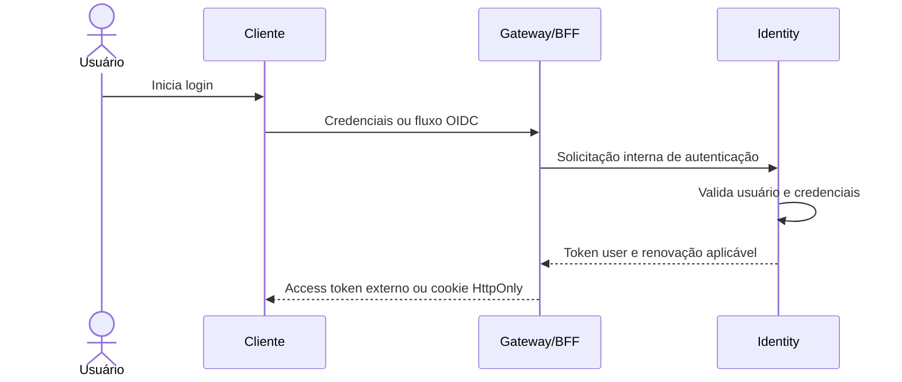

# Arquitetura-alvo de autenticação e autorização

## Status

Este documento registra as decisões obrigatórias para a migração do FIAP
Cloud Games e cobre chamadas HTTP, Workers, RabbitMQ e Kubernetes.

JWT protege chamadas HTTP. No RabbitMQ, cada aplicação autentica no broker com
credencial própria e autorização por exchange e queue; as mensagens não
carregam JWT. No Kubernetes, credenciais são fornecidas por Secret ou por um
cofre integrado, nunca por ConfigMap.

## Decisões fechadas

1. Somente o Identity emite tokens.
2. Existem apenas dois tipos de access token: `user` e `service`.
3. Não serão implementados token exchange, token delegado, `act` ou
   `origin_client_id`.
4. Tokens `user` são aceitos somente nas bordas: BFF e API Gateway.
5. APIs internas e Workers usam somente tokens `service`.
6. Cada BFF, Gateway, API e Worker possui `client_id` e segredo próprios.
7. Cada API possui uma audience própria.
8. Todo endpoint exige autenticação por padrão. Endpoints públicos usam
   `AllowAnonymous` explicitamente.
9. O BFF ou Gateway obtém o usuário do `sub` do token e envia o `userId` no
   contrato interno, pelo body ou pela rota.
10. Query string é usada para filtros, não como padrão para identidade em
    comandos.
11. APIs internas confiam no `userId` somente depois de autenticar e autorizar
    a aplicação que o enviou.
12. Regras de negócio permanecem na API dona do domínio.

## Modelo de confiança

O sistema adota o padrão Trusted Subsystem: o BFF ou Gateway autentica o
usuário na borda, cria uma nova requisição interna e se autentica como
aplicação diante da API de destino.

```text
Cliente
   │ token user
   ▼
Gateway/BFF
   │ valida usuário e autorização de entrada
   │ extrai userId do sub
   │ token service + userId no contrato
   ▼
API interna
   │ valida aplicação, audience, scope e client_id
   │ aplica regras do próprio domínio
   ▼
Outra API
   │ token service + dados necessários
   ▼
Resposta ao cliente
```

As APIs internas não recebem nem validam o token original do usuário. Elas
validam o token de serviço e tratam o `userId` como uma declaração da aplicação
autenticada.

## Tipos de token

### Token `user`

Representa o usuário na borda.

```json
{
  "iss": "fiap-cloud-games-identity",
  "aud": "web-bff",
  "sub": "47de4c37-34ab-4084-a293-e46229c34aad",
  "client_id": "web-bff",
  "scope": "store.access",
  "role": "customer",
  "token_use": "user",
  "exp": 1790031600
}
```

Regras:

- `sub` é o identificador do usuário;
- `client_id` identifica a aplicação da borda;
- a audience é o BFF ou Gateway;
- não é aceito por APIs internas;
- somente BFF ou Gateway usa `ICallerContext.UserId`.

### Token `service`

Representa uma aplicação interna.

```json
{
  "iss": "fiap-cloud-games-identity",
  "aud": "orders-api",
  "sub": "web-bff",
  "client_id": "web-bff",
  "scope": "orders.create",
  "token_use": "service",
  "exp": 1790031300
}
```

Regras:

- `sub` e `client_id` representam a mesma aplicação;
- a audience identifica somente a API de destino;
- os scopes limitam as operações técnicas;
- não contém identidade do usuário;
- `ICallerContext.UserId` é sempre `null`.

## Responsabilidades

### Identity

- autenticar usuários;
- emitir e renovar tokens `user`;
- registrar aplicações confidenciais;
- validar `client_id` e `client_secret`;
- emitir tokens `service` por Client Credentials;
- controlar audiences e scopes permitidos;
- assinar tokens com chave assimétrica;
- publicar discovery e JWKS;
- revogar e rotacionar credenciais;
- auditar emissões e falhas.

O Identity não contém regras de Orders, Payments, Catalog, Promotions ou
Library.

### BFF e API Gateway

- receber login somente pela borda pública;
- validar tokens `user`;
- obter o usuário exclusivamente do `sub` validado;
- ignorar ou sobrescrever `userId` informado pelo cliente;
- aplicar autorização de rota e proteção contra abuso;
- criar contratos internos com o `userId` correto;
- obter e armazenar em cache tokens `service`;
- nunca retornar tokens internos ao cliente.

### APIs internas

- aceitar somente `token_use=service`;
- validar assinatura, issuer, audience e expiração localmente;
- validar scopes e `client_id` permitidos;
- usar `userId` do contrato somente de chamadores autorizados;
- aplicar regras, invariantes e propriedade dos recursos do próprio domínio;
- nunca consultar o Identity para validar cada requisição.

### Workers

- autenticar no RabbitMQ com uma credencial exclusiva da aplicação;
- receber a credencial por Secret do Kubernetes;
- possuir somente as permissões necessárias nas exchanges e queues;
- não transportar JWT em mensagens;
- solicitar token `service` somente quando precisarem chamar uma API HTTP;
- não enviar `userId` quando não existir usuário associado ao processo.

## Fluxo de login



O Identity não é acessado diretamente por clientes externos. Em um BFF web,
o navegador recebe preferencialmente um cookie `HttpOnly`, `Secure` e
`SameSite`; os tokens permanecem no servidor.

## Fluxo de criação de pedido

### Contrato público

```http
POST /orders
Authorization: Bearer <token-user>
Content-Type: application/json

{
  "gameId": "80fdc742-e7c1-4564-a269-8d52784bec44"
}
```

O cliente não escolhe seu `userId`.

### Processamento na borda

```text
1. Validar token_use=user.
2. Validar issuer, audience, assinatura e expiração.
3. Extrair userId do sub.
4. Validar acesso à rota.
5. Obter token service para orders-api no cache.
6. Em cache miss, solicitar Client Credentials ao Identity.
7. Criar uma nova requisição interna.
```

### Contrato interno

```http
POST /internal/orders
Authorization: Bearer <token-service-do-bff>
Content-Type: application/json

{
  "userId": "47de4c37-34ab-4084-a293-e46229c34aad",
  "gameId": "80fdc742-e7c1-4564-a269-8d52784bec44"
}
```

O token usado nessa chamada contém:

```json
{
  "aud": "orders-api",
  "sub": "web-bff",
  "client_id": "web-bff",
  "scope": "orders.create",
  "token_use": "service"
}
```

Orders aceita o `userId` somente se o token for válido, `web-bff` estiver na
lista de clientes permitidos e o scope contiver `orders.create`.

## Fluxo de Orders para Payments pelo RabbitMQ

Depois de criar o pedido, Orders grava o evento na própria Outbox e o publica
no RabbitMQ. Nesse trecho não existe JWT:

```json
{
  "messageId": "2ace1057-8815-4675-babe-a672928b328c",
  "eventType": "OrderPlacedV1",
  "correlationId": "5ae87974-a227-4b97-9f20-3593efdad7ca",
  "producer": "orders",
  "payload": {
    "orderId": "585e4649-a9bb-4635-ab61-1424983d19d4",
    "userId": "47de4c37-34ab-4084-a293-e46229c34aad",
    "amount": 79.90,
    "currency": "BRL"
  }
}
```

O Payments Worker confia na autenticação da conexão com o RabbitMQ, nas
permissões da queue, no contrato versionado e em sua Inbox idempotente. Caso
precise consultar uma API por HTTP, ele obtém um token `service` específico
para a audience e o scope dessa chamada.

O `userId` presente no evento é um dado do processo já validado na borda. Ele
não transforma a mensagem em autenticação de usuário.

## Consulta da biblioteca

Contrato público:

```http
GET /library
Authorization: Bearer <token-user>
```

Contrato interno:

```http
GET /internal/users/47de4c37-34ab-4084-a293-e46229c34aad/library
Authorization: Bearer <token-service-do-bff>
```

O identificador fica na rota porque identifica o recurso consultado. O BFF o
obtém do `sub`; o cliente não escolhe livremente o valor.

## Convenções para `userId`

Use rota quando o usuário identificar o recurso:

```text
GET /internal/users/{userId}/library
GET /internal/users/{userId}/orders
```

Use body quando o usuário participar de um comando:

```json
{
  "userId": "47de4c37-34ab-4084-a293-e46229c34aad",
  "gameId": "80fdc742-e7c1-4564-a269-8d52784bec44"
}
```

Use query string somente para filtros:

```http
GET /internal/orders?userId=47de4c37-34ab-4084-a293-e46229c34aad
```

Para operações administrativas, diferencie executor e alvo:

```json
{
  "requestedByUserId": "admin-123",
  "targetUserId": "user-456"
}
```

O Building Blocks não lê body, rota ou query. Esses valores pertencem ao
contrato e ao domínio de cada serviço.

## Client Credentials e cache

Solicitação:

```http
POST /connect/token
Content-Type: application/x-www-form-urlencoded

grant_type=client_credentials
&client_id=orders-api
&client_secret=<secret>
&audience=payments-api
&scope=payments.create
```

Resposta:

```json
{
  "access_token": "eyJhbGciOiJSUzI1NiIs...",
  "token_type": "Bearer",
  "expires_in": 300
}
```

O chamador guarda o token em memória pela combinação de audience e scopes e
o renova antes da expiração. Requisições simultâneas compartilham a mesma
renovação. Não é feita uma chamada ao Identity para cada requisição.

As APIs validam JWT localmente com a chave pública em cache. O Identity é
consultado para emissão ou renovação, não para validação online.

## Configuração do Building Blocks

API interna:

```json
{
  "Authentication": {
    "Authority": "https://identity.internal",
    "Issuer": "fiap-cloud-games-identity",
    "Audience": "orders-api",
    "AllowedTokenUses": ["service"],
    "RequireHttpsMetadata": true,
    "ClockSkew": "00:00:30"
  }
}
```

BFF ou Gateway:

```json
{
  "Authentication": {
    "Authority": "https://identity.internal",
    "Issuer": "fiap-cloud-games-identity",
    "Audience": "web-bff",
    "AllowedTokenUses": ["user"],
    "RequireHttpsMetadata": true,
    "ClockSkew": "00:00:30"
  }
}
```

Policy interna:

```csharp
builder.Services.AddAuthorization(options =>
{
    options.AddPolicy(
        "CreateOrders",
        policy => policy
            .RequireAuthenticatedUser()
            .RequireServiceToken()
            .RequireClients("web-bff", "public-api-gateway")
            .RequireScopes("orders.create"));
});
```

Todos os endpoints são autenticados por padrão. As exceções precisam ser
explícitas:

```csharp
app.MapPost("/auth/login", Login).AllowAnonymous();
app.MapFiapHealthChecks().AllowAnonymous();
```

No Identity, discovery, JWKS e token endpoint também são públicos no nível do
middleware, mas aplicam as validações próprias do protocolo.

## Respostas de segurança

Use `401 Unauthorized` quando:

- não existe token;
- assinatura, issuer ou audience são inválidos;
- o token expirou;
- `token_use` é ausente ou não permitido;
- as claims obrigatórias são inválidas.

Use `403 Forbidden` quando:

- o token é válido;
- o `client_id` não pode executar a operação;
- falta um scope necessário.

## Regras para logs

Nunca registrar:

- access token;
- refresh token;
- client secret;
- senha;
- chave privada;
- dados completos de cartão.

Registrar apenas metadados necessários:

```text
client_id
audience
scopes
userId quando necessário para auditoria
correlationId
resultado da autorização
```

## Checklist de implementação

### Identity

- emitir `token_use=user` no login;
- emitir `token_use=service` em Client Credentials;
- garantir `sub == client_id` em tokens `service`;
- usar uma audience por API;
- validar audiences e scopes permitidos por cliente;
- publicar discovery e JWKS;
- nunca emitir token delegado.

### BFF e Gateway

- aceitar somente `token_use=user`;
- extrair usuário somente do `sub` validado;
- não aceitar `userId` externo como identidade;
- criar contratos internos separados;
- usar e armazenar em cache tokens `service`;
- não expor token interno ao cliente.

### APIs internas

- aceitar somente `token_use=service`;
- proteger endpoints por padrão;
- usar `AllowAnonymous` somente de forma explícita;
- restringir `client_id` e scopes por operação;
- receber `userId` pelo contrato quando necessário;
- manter regras de negócio no domínio responsável.

### Workers e RabbitMQ

- usar credencial exclusiva por aplicação no broker;
- aplicar permissões mínimas por exchange e queue;
- receber credenciais por Secret do Kubernetes;
- nunca colocar JWT ou client secret em mensagens;
- validar contrato e versão do evento;
- usar Inbox e consumidores idempotentes;
- obter token `service` somente para chamadas HTTP.

### Kubernetes

- expor publicamente somente BFF e Gateway;
- manter Identity e APIs de domínio em rede interna;
- não armazenar secrets em manifests versionados ou ConfigMaps;
- aplicar NetworkPolicies compatíveis com as chamadas necessárias;
- rotacionar credenciais de aplicação e RabbitMQ.

## Consequência arquitetural aceita

Um token `service` permite que uma aplicação autorizada declare diferentes
usuários nos contratos internos. Esse risco é aceito pelo padrão Trusted
Subsystem e exige credenciais exclusivas, tokens curtos, scopes mínimos, HTTPS,
rede interna e auditoria. Se no futuro for necessária prova criptográfica por
usuário entre serviços, a arquitetura poderá evoluir; isso não faz parte da
Fase 2.
