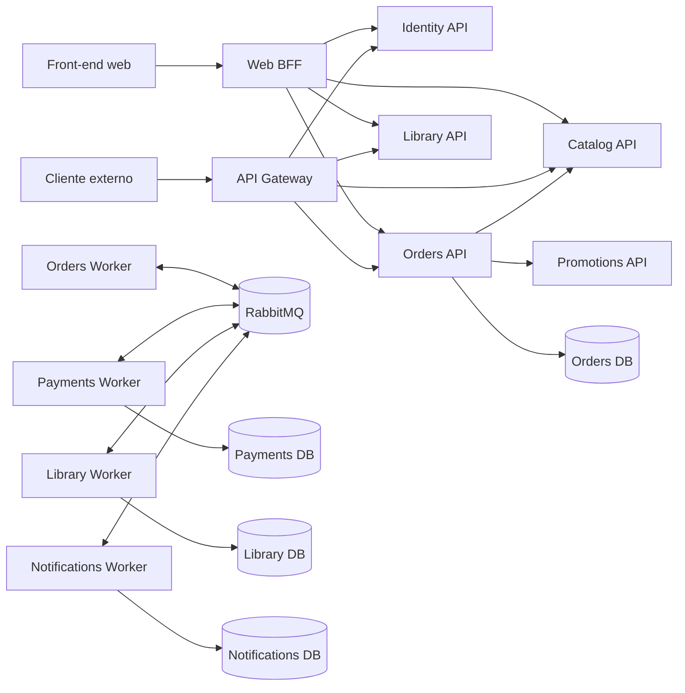
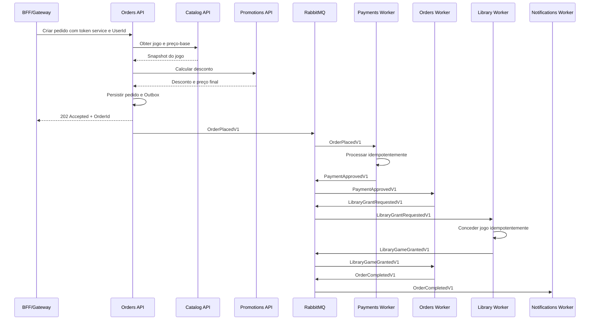

# Arquitetura-alvo de microsserviços

## Objetivo

Definir a arquitetura final do FIAP Cloud Games com fronteiras de domínio
claras, repositórios independentes, comunicação síncrona por HTTP e integração
assíncrona por RabbitMQ, executada em Kubernetes.

Os únicos módulos de domínio são:

- Identity;
- Catalog;
- Promotions;
- Orders;
- Payments;
- Library;
- Notifications.

Building Blocks é uma biblioteca técnica. BFF e API Gateway são componentes de
borda. Kubernetes e RabbitMQ são infraestrutura. Nenhum deles representa um
novo módulo de domínio.

## Classificação dos repositórios

### Domínio

| Módulo | Repositório | Solution | Banco |
|---|---|---|---|
| Identity | `fcg-identity-service` | `FiapCloudGames.Identity.slnx` | `fcg_identity` |
| Catalog | `fcg-catalog-service` | `FiapCloudGames.Catalog.slnx` | `fcg_catalog` |
| Promotions | `fcg-promotions-service` | `FiapCloudGames.Promotions.slnx` | `fcg_promotions` |
| Orders | `fcg-orders-service` | `FiapCloudGames.Orders.slnx` | `fcg_orders` |
| Payments | `fcg-payments-service` | `FiapCloudGames.Payments.slnx` | `fcg_payments` |
| Library | `fcg-library-service` | `FiapCloudGames.Library.slnx` | `fcg_library` |
| Notifications | `fcg-notifications-service` | `FiapCloudGames.Notifications.slnx` | `fcg_notifications` |

### Compartilhamento, borda e plataforma

| Categoria | Repositório | Finalidade |
|---|---|---|
| Biblioteca | `fcg-dotnet-building-blocks` | Um pacote NuGet técnico compartilhado |
| Borda web | `fcg-web-bff` | Entrada do front-end web e sessão do usuário |
| Borda pública | `fcg-api-gateway` | Entrada de clientes externos e políticas de borda |
| Plataforma | `fcg-platform` | Kubernetes, RabbitMQ, observabilidade e configuração de ambientes |

O repositório `fcg-platform` não contém regras de negócio nem código de um
microsserviço. Ele centraliza apenas os artefatos compartilhados de operação.

## Arquitetura de alto nível



## Princípios

1. Cada domínio possui seu próprio repositório, solution, banco e migrations.
2. API e Worker do mesmo domínio ficam no mesmo repositório.
3. Nenhum serviço consulta diretamente o banco de outro serviço.
4. HTTP é usado quando a resposta é necessária imediatamente.
5. RabbitMQ é usado para processos assíncronos e integração entre domínios.
6. Publicação confiável usa Outbox; consumo idempotente usa Inbox.
7. Somente BFF e Gateway são expostos aos clientes.
8. Tokens de usuário terminam na borda; APIs internas recebem tokens de serviço.
9. Mensagens do RabbitMQ não carregam JWT.
10. Kubernetes executa e isola as aplicações, mas não contém regras de negócio.
11. Building Blocks contém apenas recursos técnicos genéricos.

## Estrutura padrão de um domínio

```text
fcg-<nome>-service/
├── FiapCloudGames.<Nome>.slnx
├── Directory.Build.props
├── Directory.Packages.props
├── NuGet.Config
├── README.md
├── src/
│   ├── FiapCloudGames.<Nome>.Api/
│   ├── FiapCloudGames.<Nome>.Worker/
│   ├── FiapCloudGames.<Nome>.Application/
│   ├── FiapCloudGames.<Nome>.Domain/
│   ├── FiapCloudGames.<Nome>.Infrastructure/
│   └── FiapCloudGames.<Nome>.Contracts/
├── tests/
│   ├── FiapCloudGames.<Nome>.UnitTests/
│   ├── FiapCloudGames.<Nome>.IntegrationTests/
│   └── FiapCloudGames.<Nome>.ArchitectureTests/
├── deploy/
│   ├── api/
│   └── worker/
└── Dockerfile
```

Projetos que não precisarem de Worker não devem criar um Worker vazio. A
estrutura é uma referência, não uma obrigação de gerar todos os projetos.

## Identity

### Identificação

| Item | Valor |
|---|---|
| Repositório | `fcg-identity-service` |
| Solution | `FiapCloudGames.Identity.slnx` |
| Workload Kubernetes | `identity-api` |
| Banco | `fcg_identity` |
| Audience | `identity-api` |

### Responsabilidades

- cadastro e autenticação de usuários;
- usuários, credenciais, roles e permissões de identidade;
- refresh token e revogação;
- cadastro de aplicações por `client_id`;
- Client Credentials;
- emissão de tokens `user` e `service`;
- assinatura assimétrica e publicação de JWKS;
- audiences e scopes específicos.

### Endpoints iniciais

```text
POST /api/auth/register
POST /api/auth/login
POST /api/auth/refresh
POST /connect/token
GET  /.well-known/jwks.json
```

Login e cadastro externos passam pelo BFF ou Gateway. O serviço não é exposto
diretamente por Ingress.

## Catalog

### Identificação

| Item | Valor |
|---|---|
| Repositório | `fcg-catalog-service` |
| Solution | `FiapCloudGames.Catalog.slnx` |
| Workload Kubernetes | `catalog-api` |
| Banco | `fcg_catalog` |
| Audience | `catalog-api` |

### Responsabilidades

- cadastro e manutenção de jogos;
- título, descrição, gênero, classificação e disponibilidade;
- preço-base e moeda;
- consultas administrativas e de vitrine;
- fornecimento do snapshot de produto para Orders.

### Endpoints iniciais

```text
GET    /internal/games
GET    /internal/games/{gameId}
POST   /internal/games
PUT    /internal/games/{gameId}
DELETE /internal/games/{gameId}
```

Catalog não aplica descontos e não conhece pedidos ou pagamentos.

## Promotions

### Identificação

| Item | Valor |
|---|---|
| Repositório | `fcg-promotions-service` |
| Solution | `FiapCloudGames.Promotions.slnx` |
| Workload Kubernetes | `promotions-api` |
| Banco | `fcg_promotions` |
| Audience | `promotions-api` |

### Responsabilidades

- campanhas promocionais;
- descontos fixos ou percentuais;
- período de vigência;
- elegibilidade por jogo ou regra;
- cálculo do desconto sobre um preço-base recebido;
- retorno do preço final e da promoção aplicada.

### Endpoint interno de cálculo

```text
POST /internal/promotions/calculate
```

Exemplo de entrada:

```json
{
  "gameId": "80fdc742-e7c1-4564-a269-8d52784bec44",
  "basePrice": 99.90,
  "currency": "BRL",
  "calculatedAt": "2026-09-24T18:00:00Z"
}
```

Promotions não consulta o banco do Catalog. Orders fornece o preço-base que
acabou de obter do Catalog.

## Orders

### Identificação

| Item | Valor |
|---|---|
| Repositório | `fcg-orders-service` |
| Solution | `FiapCloudGames.Orders.slnx` |
| Workloads Kubernetes | `orders-api`, `orders-worker` |
| Banco | `fcg_orders` |
| Audience | `orders-api` |

### Responsabilidades

- criação idempotente do pedido;
- associação entre usuário e itens;
- consulta síncrona de Catalog e Promotions;
- snapshot do jogo, preço-base, desconto, preço final e moeda;
- máquina de estados do pedido;
- Outbox de eventos de pedido;
- consumo idempotente de resultados de Payments e Library;
- consulta do status da compra.

### Estados iniciais

```text
PendingPayment
PaymentApproved
PaymentRejected
LibraryPending
Completed
Failed
Cancelled
```

### Endpoints iniciais

```text
POST /internal/orders
GET  /internal/orders/{orderId}
GET  /internal/users/{userId}/orders
POST /internal/orders/{orderId}/retry
```

### Eventos

Publica:

- `OrderPlacedV1`;
- `LibraryGrantRequestedV1`;
- `OrderCompletedV1`;
- `OrderFailedV1`.

Consome:

- `PaymentApprovedV1`;
- `PaymentRejectedV1`;
- `LibraryGameGrantedV1`;
- `LibraryGameGrantFailedV1`.

## Payments

### Identificação

| Item | Valor |
|---|---|
| Repositório | `fcg-payments-service` |
| Solution | `FiapCloudGames.Payments.slnx` |
| Workloads Kubernetes | `payments-api`, `payments-worker` |
| Banco | `fcg_payments` |
| Audience | `payments-api` |

### Responsabilidades

- consumir `OrderPlacedV1`;
- criar pagamento idempotente por `OrderId`;
- simular ou integrar o provedor de pagamento;
- registrar tentativas e resultado;
- não armazenar dados completos de cartão;
- publicar aprovação ou rejeição;
- permitir consulta interna de diagnóstico.

### Endpoints iniciais

```text
GET  /internal/payments/{paymentId}
GET  /internal/orders/{orderId}/payment
POST /internal/payments/{paymentId}/retry
```

### Eventos

Consome `OrderPlacedV1` e publica `PaymentApprovedV1` ou
`PaymentRejectedV1`.

## Library

### Identificação

| Item | Valor |
|---|---|
| Repositório | `fcg-library-service` |
| Solution | `FiapCloudGames.Library.slnx` |
| Workloads Kubernetes | `library-api`, `library-worker` |
| Banco | `fcg_library` |
| Audience | `library-api` |

### Responsabilidades

- representar os jogos adquiridos por cada usuário;
- consultar a biblioteca do usuário;
- consumir solicitações de concessão;
- conceder cada jogo uma única vez;
- impedir duplicidade por usuário, jogo e pedido;
- publicar o resultado da concessão.

### Endpoints iniciais

```text
GET /internal/users/{userId}/library
GET /internal/users/{userId}/library/{gameId}
```

### Eventos

Consome `LibraryGrantRequestedV1` e publica `LibraryGameGrantedV1` ou
`LibraryGameGrantFailedV1`.

Library não inicia compra e não processa pagamento.

## Notifications

### Identificação

| Item | Valor |
|---|---|
| Repositório | `fcg-notifications-service` |
| Solution | `FiapCloudGames.Notifications.slnx` |
| Workloads Kubernetes | `notifications-api`, `notifications-worker` |
| Banco | `fcg_notifications` |
| Audience | `notifications-api` |

### Responsabilidades

- consumir eventos relevantes da compra;
- montar mensagens a partir de templates;
- simular ou integrar e-mail e outros canais;
- registrar tentativas e resultados;
- impedir envios duplicados;
- permitir consulta e reprocessamento administrativo.

### Endpoints iniciais

```text
GET  /internal/notifications/{notificationId}
POST /internal/notifications/{notificationId}/retry
```

### Eventos consumidos

- `PaymentApprovedV1`;
- `PaymentRejectedV1`;
- `OrderCompletedV1`;
- `OrderFailedV1`.

Falhas de notificação nunca desfazem pagamento, Library ou pedido.

## BFF e API Gateway

### Web BFF

O `fcg-web-bff` atende somente o front-end web:

- encaminha login e cadastro ao Identity;
- valida o token `user` ou mantém uma sessão segura no servidor;
- extrai o `UserId` do `sub` validado;
- obtém tokens `service` para chamar APIs internas;
- monta contratos internos sem confiar em `userId` vindo do navegador;
- agrega respostas quando necessário.

### API Gateway

O `fcg-api-gateway` atende clientes externos:

- encaminha login e cadastro ao Identity;
- valida tokens de usuário;
- aplica rate limit, CORS, limites de payload e políticas de borda;
- extrai o `UserId` do token validado;
- chama APIs internas com token `service`;
- nunca expõe rotas `/internal` diretamente.

BFF e Gateway são pontas paralelas. Um não precisa obrigatoriamente encaminhar
suas chamadas pelo outro.

## RabbitMQ

### Papel na arquitetura

RabbitMQ executa a integração assíncrona do fluxo de compra. Ele não substitui
o banco de cada serviço e não é usado para consultas que exigem resposta
imediata.

### Segurança

- TLS nos ambientes compartilhados;
- credencial própria para cada serviço;
- permissões mínimas por exchange e queue;
- secrets fornecidos pelo Kubernetes;
- Management UI sem exposição pública;
- mensagens não carregam JWT, refresh token ou client secret.

### Confiabilidade

- Outbox transacional no serviço publicador;
- Inbox ou registro equivalente no consumidor;
- `MessageId` único;
- consumidores idempotentes;
- retry com limite e backoff;
- dead-letter queue por fluxo;
- ack somente depois da persistência local;
- observabilidade por correlation e causation IDs.

### Topologia inicial

```text
exchange: fcg.events

orders.order-placed.v1              -> payments.order-placed
payments.payment-approved.v1        -> orders.payment-approved
payments.payment-approved.v1        -> notifications.payment-approved
payments.payment-rejected.v1        -> orders.payment-rejected
payments.payment-rejected.v1        -> notifications.payment-rejected
orders.library-grant-requested.v1    -> library.grant-requested
library.game-granted.v1             -> orders.game-granted
library.game-grant-failed.v1        -> orders.game-grant-failed
orders.order-completed.v1            -> notifications.order-completed
orders.order-failed.v1               -> notifications.order-failed
```

Os nomes físicos podem receber prefixo do ambiente, como `dev.`, `hml.` ou
`prod.`.

## Contrato mínimo dos eventos

Todo evento terá um envelope comum:

```json
{
  "messageId": "2ace1057-8815-4675-babe-a672928b328c",
  "eventType": "OrderPlacedV1",
  "occurredAt": "2026-09-24T18:00:00Z",
  "correlationId": "5ae87974-a227-4b97-9f20-3593efdad7ca",
  "causationId": null,
  "producer": "orders",
  "payload": {}
}
```

O schema canônico fica no repositório do produtor. Nesta fase não será criado
um NuGet para cada contrato. Consumidores mantêm seus DTOs locais e executam
testes de contrato usando exemplos e JSON Schemas versionados publicados pelo
produtor.

## Fluxo completo de compra



O cliente consulta o estado do pedido. Atualização em tempo real por WebSocket
ou Server-Sent Events pode ser adicionada sem alterar o fluxo principal.

## Kubernetes

### Repositório de plataforma

```text
fcg-platform/
├── environments/
│   ├── dev/
│   ├── hml/
│   └── prod/
├── base/
│   ├── namespaces/
│   ├── rabbitmq/
│   ├── ingress/
│   ├── observability/
│   └── policies/
└── README.md
```

Cada repositório de aplicação mantém o manifesto ou chart do próprio workload.
O repositório de plataforma compõe os ambientes e mantém os componentes
compartilhados.

### Regras iniciais

- `Deployment` separado para API e Worker;
- `Service` ClusterIP somente para componentes HTTP;
- Ingress público somente para BFF e Gateway;
- Identity e APIs de domínio acessíveis apenas internamente;
- `ConfigMap` somente para configuração não sensível;
- `Secret` ou cofre externo para credenciais;
- readiness e liveness probes;
- requests e limits de CPU e memória;
- `PodDisruptionBudget` quando houver mais de uma réplica;
- `NetworkPolicy` restringindo comunicação entre workloads;
- migrations executadas por Job controlado, não por todas as réplicas;
- RabbitMQ com armazenamento persistente e política de backup.

Kubernetes não substitui migrations, retry de aplicação, idempotência ou
Outbox/Inbox.

## Bancos e isolamento

Em desenvolvimento pode existir uma única instância PostgreSQL, mas com bancos
e usuários separados:

```text
fcg_identity       <- fcg_identity_app
fcg_catalog        <- fcg_catalog_app
fcg_promotions     <- fcg_promotions_app
fcg_orders         <- fcg_orders_app
fcg_payments       <- fcg_payments_app
fcg_library        <- fcg_library_app
fcg_notifications  <- fcg_notifications_app
```

Um usuário de aplicação não recebe permissão no banco de outro serviço.

## Observabilidade mínima

- logs estruturados;
- `CorrelationId` em HTTP e mensagens;
- `MessageId` e `CausationId` nos eventos;
- métricas de API, Worker, RabbitMQ e banco;
- contagem de retries e mensagens em dead-letter;
- tracing distribuído;
- dashboards por serviço;
- alertas para indisponibilidade, backlog e falha repetida.

Dados sensíveis, tokens e secrets nunca são registrados.

## Estratégia de testes

Cada serviço terá:

- testes unitários de domínio;
- testes de integração com o banco;
- testes de API;
- testes de autorização;
- testes de arquitetura;
- testes de contrato HTTP;
- testes de contrato de eventos;
- testes de idempotência de consumidor;
- testes de integração com RabbitMQ usando ambiente efêmero.

O ambiente integrado terá testes ponta a ponta para login, catálogo, promoção,
compra aprovada, pagamento rejeitado, duplicidade, recuperação de falha e
consulta da Library.

## Decisões fechadas

| Tema | Decisão |
|---|---|
| Módulos de domínio | Somente os sete listados neste documento |
| Compartilhamento .NET | Um único pacote Building Blocks inicialmente |
| Borda web | BFF |
| Outros clientes | API Gateway |
| Identidade externa | Sempre acessada por BFF ou Gateway |
| Token interno HTTP | `service` |
| Mensageria | RabbitMQ |
| Garantia de publicação | Outbox |
| Garantia de consumo | Inbox e idempotência |
| Orquestração de compra | Orders mantém o estado do processo |
| Contratos de evento | JSON Schema versionado no produtor, sem novo NuGet inicialmente |
| Plataforma | Kubernetes |
| Manifests compartilhados | `fcg-platform` |
| Banco | Um banco e usuário por domínio |

## Pontos que podem ser adiados sem mudar a arquitetura

- provedor real de pagamento;
- provedor real de e-mail;
- cofre de secrets gerenciado;
- autoscaling baseado no backlog do RabbitMQ;
- service mesh;
- atualização em tempo real no front-end;
- alta disponibilidade do RabbitMQ no ambiente acadêmico.

Esses itens mudam implementação e operação, mas não criam novos módulos.
