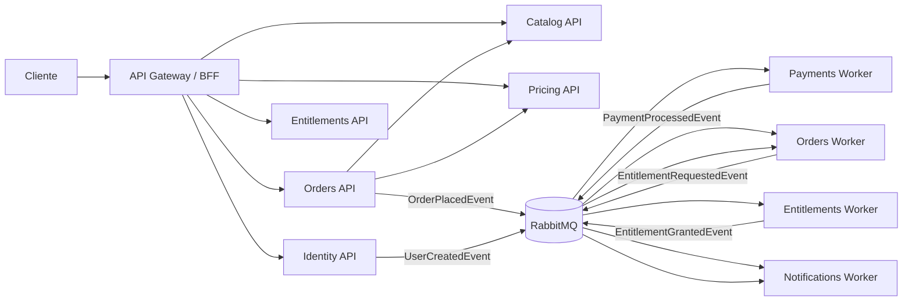
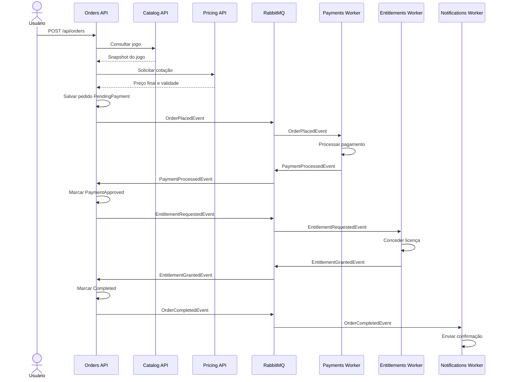

# Arquitetura-alvo de microsserviços

## Objetivo

Este documento descreve uma arquitetura-alvo para a evolução da FIAP Cloud
Games de um monólito modular para uma plataforma de distribuição digital de
jogos semelhante, em responsabilidades, a Steam ou Epic Games Store.

A proposta separa os serviços por capacidade de negócio. Cada microsserviço é
dono do próprio código, dados, migrations, contratos e ciclo de implantação.
APIs, Workers e migrations pertencentes ao mesmo domínio permanecem no mesmo
repositório, ainda que sejam executáveis e containers diferentes.

## Visão geral

| Domínio | Repositório | Solution | Banco lógico |
|---|---|---|---|
| Identidade e usuários | `fcg-identity-service` | `FiapCloudGames.Identity.sln` | `fcg_identity` |
| Catálogo | `fcg-catalog-service` | `FiapCloudGames.Catalog.sln` | `fcg_catalog` |
| Preços e promoções | `fcg-pricing-service` | `FiapCloudGames.Pricing.sln` | `fcg_pricing` |
| Pedidos | `fcg-orders-service` | `FiapCloudGames.Orders.sln` | `fcg_orders` |
| Pagamentos | `fcg-payments-service` | `FiapCloudGames.Payments.sln` | `fcg_payments` |
| Direitos e biblioteca | `fcg-entitlements-service` | `FiapCloudGames.Entitlements.sln` | `fcg_entitlements` |
| Notificações | `fcg-notifications-service` | `FiapCloudGames.Notifications.sln` | `fcg_notifications` |
| Infraestrutura compartilhada | `fcg-platform` | Não se aplica | Não possui banco de negócio |

## Arquitetura de alto nível



## Princípios de organização

1. Um repositório representa um domínio implantável, não uma camada técnica.
2. API, Worker, Domain, Application, Infrastructure e Migrations do mesmo
   serviço ficam no mesmo repositório.
3. Cada serviço possui seu banco lógico e seu usuário de banco.
4. Nenhum serviço acessa tabelas pertencentes a outro serviço.
5. Integrações síncronas usam HTTP somente quando a resposta é necessária para
   continuar a requisição.
6. Mudanças de estado e processos longos usam eventos assíncronos.
7. Eventos são idempotentes, versionados e rastreáveis por `CorrelationId`.
8. Outbox é usada nos produtores e Inbox nos consumidores importantes.
9. Cada serviço possui health checks, logs estruturados e rastreamento
   distribuído.

O fluxo de identidade de usuário, BFF, Gateway, Client Credentials, tokens
técnicos e Workers está detalhado em
[Autenticação e autorização da arquitetura-alvo](target-authentication.md).

---

## 1. Identity Service

### Identificação

| Item | Valor |
|---|---|
| Repositório | `fcg-identity-service` |
| Solution | `FiapCloudGames.Identity.sln` |
| API/Service Kubernetes | `identity-api` |
| Banco | `fcg_identity` |
| Usuário do banco | `fcg_identity_app` |
| Nome compatível com a atividade | `UsersAPI` |

### Finalidade

É a autoridade sobre identidade, credenciais e acesso. Responde quem é o
usuário, como ele autentica e quais permissões possui.

### Responsabilidades

- cadastrar usuários;
- autenticar credenciais;
- emitir tokens JWT;
- renovar e revogar sessões;
- gerenciar papéis e permissões;
- alterar dados de conta;
- desativar ou bloquear usuários;
- publicar `UserCreatedEvent`;
- proteger senhas e dados de autenticação.

### Fora de responsabilidade

- jogos comprados pelo usuário;
- pedidos e pagamentos;
- envio de e-mail;
- preferências comerciais;
- dados de cartão.

### Estrutura sugerida

```text
fcg-identity-service/
├── FiapCloudGames.Identity.sln
├── src/
│   ├── FiapCloudGames.Identity.Api/
│   ├── FiapCloudGames.Identity.Application/
│   ├── FiapCloudGames.Identity.Domain/
│   ├── FiapCloudGames.Identity.Infrastructure/
│   ├── FiapCloudGames.Identity.Contracts/
│   └── FiapCloudGames.Identity.Migrations/
├── tests/
│   ├── FiapCloudGames.Identity.UnitTests/
│   ├── FiapCloudGames.Identity.IntegrationTests/
│   └── FiapCloudGames.Identity.ArchitectureTests/
├── k8s/
├── Dockerfile
└── README.md
```

### Dados principais

- `users`;
- `roles`;
- `user_roles`;
- `refresh_tokens`;
- `outbox_messages`.

### Endpoints principais

```text
POST   /api/users
POST   /api/auth/login
POST   /api/auth/refresh
POST   /api/auth/logout
GET    /api/users/me
PUT    /api/users/me
GET    /api/users/{id}
DELETE /api/users/{id}
```

### Eventos publicados

- `UserCreatedEvent`;
- `UserDeactivatedEvent`, em uma evolução futura;
- `UserEmailChangedEvent`, em uma evolução futura.

### Eventos consumidos

Nenhum evento é obrigatório na primeira versão.

### Origem no projeto atual

O serviço nasce principalmente do módulo `Identity`, incluindo Domain,
Application, Infrastructure, Presentation, Contracts e suas migrations.

---

## 2. Catalog Service

### Identificação

| Item | Valor |
|---|---|
| Repositório | `fcg-catalog-service` |
| Solution | `FiapCloudGames.Catalog.sln` |
| API/Service Kubernetes | `catalog-api` |
| Banco | `fcg_catalog` |
| Usuário do banco | `fcg_catalog_app` |
| Nome compatível com a atividade | `CatalogAPI` |

### Finalidade

É a autoridade sobre o produto digital. Descreve o que é um jogo e quais
conteúdos estão disponíveis na loja.

### Responsabilidades

- cadastrar e atualizar jogos;
- manter título, descrição, gênero e classificação;
- manter desenvolvedora e publicadora;
- controlar disponibilidade comercial;
- gerenciar edições, DLCs e bundles de conteúdo;
- fornecer informações para loja, busca e criação de pedidos;
- publicar mudanças relevantes do catálogo.

### Fora de responsabilidade

- preço final e regras de desconto;
- estado da compra;
- processamento financeiro;
- propriedade do jogo pelo usuário;
- entrega de notificações.

### Estrutura sugerida

```text
fcg-catalog-service/
├── FiapCloudGames.Catalog.sln
├── src/
│   ├── FiapCloudGames.Catalog.Api/
│   ├── FiapCloudGames.Catalog.Application/
│   ├── FiapCloudGames.Catalog.Domain/
│   ├── FiapCloudGames.Catalog.Infrastructure/
│   ├── FiapCloudGames.Catalog.Contracts/
│   └── FiapCloudGames.Catalog.Migrations/
├── tests/
│   ├── FiapCloudGames.Catalog.UnitTests/
│   ├── FiapCloudGames.Catalog.IntegrationTests/
│   └── FiapCloudGames.Catalog.ArchitectureTests/
├── k8s/
├── Dockerfile
└── README.md
```

### Dados principais

- `games`;
- `publishers`;
- `developers`;
- `genres`;
- `game_genres`;
- `game_editions`;
- `downloadable_contents`;
- `outbox_messages`.

### Endpoints principais

```text
GET    /api/games
GET    /api/games/{id}
POST   /api/games
PUT    /api/games/{id}
DELETE /api/games/{id}
GET    /api/games/{id}/editions
GET    /api/games/{id}/dlcs
```

### Eventos publicados

- `GameCreatedEvent`;
- `GameUpdatedEvent`;
- `GameDeactivatedEvent`;
- `GameEditionCreatedEvent`, em uma evolução futura.

### Eventos consumidos

Nenhum evento é obrigatório na primeira versão.

### Origem no projeto atual

O serviço nasce do módulo `Catalog`. O preço-base atual deve ser migrado para o
Pricing Service quando a separação estiver concluída, permanecendo no Catalog
somente durante uma transição controlada.

---

## 3. Pricing & Promotions Service

### Identificação

| Item | Valor |
|---|---|
| Repositório | `fcg-pricing-service` |
| Solution | `FiapCloudGames.Pricing.sln` |
| API/Service Kubernetes | `pricing-api` |
| Banco | `fcg_pricing` |
| Usuário do banco | `fcg_pricing_app` |

### Finalidade

É a autoridade sobre preços e condições comerciais. Responde quanto um produto
custa para determinado país, moeda, momento e contexto promocional.

### Responsabilidades

- manter preços por região e moeda;
- criar e encerrar promoções;
- aplicar descontos;
- controlar validade das campanhas;
- calcular o melhor preço vigente;
- manter histórico de preços;
- suportar cupons e bundles em evoluções futuras;
- devolver uma cotação imutável para o Orders Service.

### Fora de responsabilidade

- descrição completa do jogo;
- criação e conclusão de pedidos;
- cobrança financeira;
- concessão de acesso ao jogo.

### Estrutura sugerida

```text
fcg-pricing-service/
├── FiapCloudGames.Pricing.sln
├── src/
│   ├── FiapCloudGames.Pricing.Api/
│   ├── FiapCloudGames.Pricing.Application/
│   ├── FiapCloudGames.Pricing.Domain/
│   ├── FiapCloudGames.Pricing.Infrastructure/
│   ├── FiapCloudGames.Pricing.Contracts/
│   └── FiapCloudGames.Pricing.Migrations/
├── tests/
│   ├── FiapCloudGames.Pricing.UnitTests/
│   ├── FiapCloudGames.Pricing.IntegrationTests/
│   └── FiapCloudGames.Pricing.ArchitectureTests/
├── k8s/
├── Dockerfile
└── README.md
```

### Dados principais

- `game_prices`;
- `regional_prices`;
- `promotions`;
- `promotion_games`;
- `coupons`, futuramente;
- `price_history`;
- `outbox_messages`;
- `inbox_messages`.

### Endpoints principais

```text
GET    /api/prices/games/{gameId}/quote
GET    /api/prices/games/{gameId}
PUT    /api/prices/games/{gameId}
GET    /api/promotions
GET    /api/promotions/{id}
POST   /api/promotions
PUT    /api/promotions/{id}
DELETE /api/promotions/{id}
```

Uma cotação deve possuir prazo de validade e dados suficientes para ser salva
como snapshot no pedido:

```text
QuoteId
GameId
BasePrice
Discount
FinalPrice
Currency
PromotionId
ValidUntilUtc
```

### Eventos publicados

- `PriceChangedEvent`;
- `PromotionCreatedEvent`;
- `PromotionEndedEvent`.

### Eventos consumidos

- `GameCreatedEvent`;
- `GameUpdatedEvent`;
- `GameDeactivatedEvent`.

Esses eventos podem alimentar uma pequena projeção local com as referências de
produtos necessárias para validar preços e promoções.

### Origem no projeto atual

O serviço nasce principalmente do módulo `Promotions`. O value object de preço
e as regras de preço-base atualmente presentes no Catalog devem ser movidos ou
adaptados para este domínio.

---

## 4. Orders Service

### Identificação

| Item | Valor |
|---|---|
| Repositório | `fcg-orders-service` |
| Solution | `FiapCloudGames.Orders.sln` |
| API/Service Kubernetes | `orders-api` |
| Worker Kubernetes | `orders-worker` |
| Banco | `fcg_orders` |
| Usuário do banco | `fcg_orders_app` |

### Finalidade

É a autoridade sobre a compra como processo de negócio. Registra a intenção de
compra, preserva o snapshot comercial e coordena a Saga até que o pagamento e a
concessão do jogo tenham sido concluídos.

### Responsabilidades

- criar pedidos;
- consultar Catalog para validar o produto;
- solicitar cotação ao Pricing;
- salvar preço e descrição como snapshot;
- controlar estados do pedido;
- iniciar o processamento do pagamento;
- reagir à aprovação ou rejeição;
- solicitar a concessão do entitlement;
- concluir, cancelar e futuramente reembolsar pedidos;
- fornecer histórico de compras do usuário.

### Fora de responsabilidade

- processar cartão, Pix ou outro meio financeiro;
- cadastrar jogos;
- calcular internamente regras promocionais;
- criar diretamente registros na biblioteca;
- enviar e-mail.

### Estrutura sugerida

```text
fcg-orders-service/
├── FiapCloudGames.Orders.sln
├── src/
│   ├── FiapCloudGames.Orders.Api/
│   ├── FiapCloudGames.Orders.Worker/
│   ├── FiapCloudGames.Orders.Application/
│   ├── FiapCloudGames.Orders.Domain/
│   ├── FiapCloudGames.Orders.Infrastructure/
│   ├── FiapCloudGames.Orders.Contracts/
│   └── FiapCloudGames.Orders.Migrations/
├── tests/
│   ├── FiapCloudGames.Orders.UnitTests/
│   ├── FiapCloudGames.Orders.IntegrationTests/
│   └── FiapCloudGames.Orders.ArchitectureTests/
├── k8s/
├── Dockerfile.Api
├── Dockerfile.Worker
└── README.md
```

### Dados principais

- `orders`;
- `order_items`;
- `order_status_history`;
- `outbox_messages`;
- `inbox_messages`.

### Estados iniciais

```text
Created
PendingPayment
PaymentRejected
PaymentApproved
GrantingEntitlement
Completed
Cancelled
Failed
```

Estados futuros:

```text
RefundPending
Refunded
PartiallyRefunded
```

### Endpoints principais

```text
POST /api/orders
GET  /api/orders/{id}
GET  /api/orders/me
POST /api/orders/{id}/cancel
POST /api/orders/{id}/retry-payment
POST /api/orders/{id}/refund
```

Os três primeiros são suficientes para a primeira entrega.

### Eventos publicados

- `OrderPlacedEvent`;
- `EntitlementRequestedEvent`;
- `OrderCompletedEvent`;
- `OrderCancelledEvent`;
- `OrderRefundedEvent`, futuramente.

### Eventos consumidos

- `PaymentProcessedEvent`;
- `EntitlementGrantedEvent`;
- `EntitlementGrantFailedEvent`;
- `EntitlementRevokedEvent`, futuramente.

### Origem no projeto atual

É um domínio novo. O endpoint atual de aquisição da Library serve como ponto de
partida funcional, mas sua lógica deve mudar: em vez de adicionar o jogo
imediatamente, ele deve criar um pedido pendente e iniciar o fluxo assíncrono.

---

## 5. Payments Service

### Identificação

| Item | Valor |
|---|---|
| Repositório | `fcg-payments-service` |
| Solution | `FiapCloudGames.Payments.sln` |
| API/Service Kubernetes | `payments-api` |
| Worker Kubernetes | `payments-worker` |
| Banco | `fcg_payments` |
| Usuário do banco | `fcg_payments_app` |
| Nome compatível com a atividade | `PaymentsAPI` |

### Finalidade

É a autoridade sobre tentativas e resultados financeiros. Na fase acadêmica,
simula aprovação ou rejeição; em uma plataforma real, integra com provedores de
pagamento e antifraude.

### Responsabilidades

- consumir pedidos criados;
- criar tentativas de pagamento;
- simular ou solicitar autorização financeira;
- registrar aprovação e rejeição;
- impedir cobrança duplicada;
- publicar o resultado do processamento;
- suportar retentativas;
- processar reembolsos futuramente;
- manter referências do provedor financeiro.

### Fora de responsabilidade

- manter dados completos de cartão;
- decidir preço ou desconto;
- concluir o pedido comercial;
- conceder o jogo ao usuário;
- enviar confirmação por e-mail.

### Estrutura sugerida

```text
fcg-payments-service/
├── FiapCloudGames.Payments.sln
├── src/
│   ├── FiapCloudGames.Payments.Api/
│   ├── FiapCloudGames.Payments.Worker/
│   ├── FiapCloudGames.Payments.Application/
│   ├── FiapCloudGames.Payments.Domain/
│   ├── FiapCloudGames.Payments.Infrastructure/
│   ├── FiapCloudGames.Payments.Contracts/
│   └── FiapCloudGames.Payments.Migrations/
├── tests/
│   ├── FiapCloudGames.Payments.UnitTests/
│   ├── FiapCloudGames.Payments.IntegrationTests/
│   └── FiapCloudGames.Payments.ArchitectureTests/
├── k8s/
├── Dockerfile.Api
├── Dockerfile.Worker
└── README.md
```

### Dados principais

- `payments`;
- `payment_attempts`;
- `refunds`;
- `outbox_messages`;
- `inbox_messages`.

### Endpoints principais

```text
GET  /api/payments/{id}
GET  /api/payments/orders/{orderId}
POST /api/payments/{id}/refund
```

O processamento principal começa pela mensageria, não pelo endpoint HTTP.

### Eventos publicados

- `PaymentProcessedEvent`, com status `Approved` ou `Rejected`;
- `PaymentRefundedEvent`, futuramente.

### Eventos consumidos

- `OrderPlacedEvent`;
- `OrderRefundRequestedEvent`, futuramente.

### Origem no projeto atual

É um domínio novo.

---

## 6. Entitlements & Library Service

### Identificação

| Item | Valor |
|---|---|
| Repositório | `fcg-entitlements-service` |
| Solution | `FiapCloudGames.Entitlements.sln` |
| API/Service Kubernetes | `entitlements-api` |
| Worker Kubernetes | `entitlements-worker` |
| Banco | `fcg_entitlements` |
| Usuário do banco | `fcg_entitlements_app` |

### Finalidade

É a autoridade sobre o direito de acesso a produtos digitais. A Library é a
visão dos entitlements ativos pertencentes ao usuário.

### Responsabilidades

- conceder direito de acesso a um jogo;
- garantir que a concessão seja idempotente;
- impedir duplicidade de licença;
- revogar acesso após reembolso, fraude ou decisão administrativa;
- manter histórico da concessão;
- responder se um usuário pode acessar determinado jogo;
- listar a biblioteca do usuário;
- suportar compras, presentes, promoções e assinaturas futuramente.

### Fora de responsabilidade

- autenticar credenciais;
- cadastrar o jogo;
- calcular o preço;
- processar pagamento;
- controlar o estado geral do pedido.

### Estrutura sugerida

```text
fcg-entitlements-service/
├── FiapCloudGames.Entitlements.sln
├── src/
│   ├── FiapCloudGames.Entitlements.Api/
│   ├── FiapCloudGames.Entitlements.Worker/
│   ├── FiapCloudGames.Entitlements.Application/
│   ├── FiapCloudGames.Entitlements.Domain/
│   ├── FiapCloudGames.Entitlements.Infrastructure/
│   ├── FiapCloudGames.Entitlements.Contracts/
│   └── FiapCloudGames.Entitlements.Migrations/
├── tests/
│   ├── FiapCloudGames.Entitlements.UnitTests/
│   ├── FiapCloudGames.Entitlements.IntegrationTests/
│   └── FiapCloudGames.Entitlements.ArchitectureTests/
├── k8s/
├── Dockerfile.Api
├── Dockerfile.Worker
└── README.md
```

### Dados principais

- `entitlements`;
- `entitlement_history`;
- `library_items`, caso seja necessária uma projeção separada;
- `game_snapshots`, caso a Library precise exibir dados sem consultar Catalog;
- `outbox_messages`;
- `inbox_messages`.

### Tipos iniciais de entitlement

```text
Purchase
Gift
Promotion
Subscription
DeveloperGrant
```

### Estados iniciais

```text
Active
Suspended
Revoked
Expired
```

### Endpoints principais

```text
GET /api/library/me
GET /api/library/me/games/{gameId}
GET /api/entitlements/{id}
GET /api/entitlements/check?userId={userId}&gameId={gameId}
```

Endpoints administrativos de concessão e revogação devem exigir autorização
forte e não precisam existir na primeira versão.

### Eventos publicados

- `EntitlementGrantedEvent`;
- `EntitlementGrantFailedEvent`;
- `EntitlementRevokedEvent`;
- `LibraryUpdatedEvent`, futuramente.

### Eventos consumidos

- `EntitlementRequestedEvent`;
- `OrderRefundedEvent`, futuramente;
- eventos do Catalog para atualizar a projeção de jogos, caso ela seja usada.

### Origem no projeto atual

O serviço nasce do módulo `Library`. A operação de aquisição deve ser removida
desse módulo: Library deixa de iniciar a compra e passa a materializar o direito
concedido depois da confirmação financeira.

---

## 7. Notifications Service

### Identificação

| Item | Valor |
|---|---|
| Repositório | `fcg-notifications-service` |
| Solution | `FiapCloudGames.Notifications.sln` |
| API/Service Kubernetes | `notifications-api`, opcional |
| Worker Kubernetes | `notifications-worker` |
| Banco | `fcg_notifications`, opcional na primeira versão |
| Usuário do banco | `fcg_notifications_app` |
| Nome compatível com a atividade | `NotificationsAPI` |

### Finalidade

Transforma acontecimentos do sistema em comunicações para o usuário. Na fase
acadêmica, simula o envio registrando a mensagem no console.

### Responsabilidades

- consumir eventos relevantes;
- gerar mensagem a partir de templates;
- simular ou executar o envio de e-mail;
- registrar tentativas e falhas;
- aplicar retry com limite;
- impedir notificações duplicadas;
- respeitar preferências do usuário futuramente;
- suportar e-mail, push e notificações internas futuramente.

### Fora de responsabilidade

- criar usuários;
- aprovar pagamentos;
- conceder jogos;
- controlar estado de pedidos.

### Estrutura sugerida

```text
fcg-notifications-service/
├── FiapCloudGames.Notifications.sln
├── src/
│   ├── FiapCloudGames.Notifications.Api/
│   ├── FiapCloudGames.Notifications.Worker/
│   ├── FiapCloudGames.Notifications.Application/
│   ├── FiapCloudGames.Notifications.Domain/
│   ├── FiapCloudGames.Notifications.Infrastructure/
│   ├── FiapCloudGames.Notifications.Contracts/
│   └── FiapCloudGames.Notifications.Migrations/
├── tests/
│   ├── FiapCloudGames.Notifications.UnitTests/
│   ├── FiapCloudGames.Notifications.IntegrationTests/
│   └── FiapCloudGames.Notifications.ArchitectureTests/
├── k8s/
├── Dockerfile.Api
├── Dockerfile.Worker
└── README.md
```

Na primeira versão, `Api`, `Domain` e `Migrations` podem ser omitidos se o
serviço apenas consumir eventos e escrever no console.

### Dados principais

- `notifications`;
- `notification_attempts`;
- `templates`;
- `user_preferences`, futuramente;
- `inbox_messages`.

### Endpoints principais

```text
GET /api/notifications/{id}
GET /api/notifications/me
PUT /api/notifications/preferences
```

Esses endpoints são evoluções; o Worker é suficiente para o primeiro escopo.

### Eventos publicados

- `NotificationSentEvent`, opcional;
- `NotificationFailedEvent`, opcional.

### Eventos consumidos

- `UserCreatedEvent`;
- `PaymentProcessedEvent` para confirmação de pagamento aprovado;
- `OrderCompletedEvent` para confirmação final de compra;
- eventos de redefinição de senha e campanhas futuramente.

### Origem no projeto atual

É um domínio novo.

---

## 8. Platform e orquestração

`fcg-platform` não é um microsserviço. É o repositório que permite executar e
implantar a plataforma completa.

### Estrutura sugerida

```text
fcg-platform/
├── docker-compose.yml
├── .env.example
├── scripts/
│   ├── create-local-databases.ps1
│   ├── wait-for-services.ps1
│   └── demo-purchase-flow.ps1
├── postgres/
│   └── init-databases.sql
├── rabbitmq/
│   └── definitions.json
├── k8s/
│   ├── namespace.yaml
│   ├── configmaps/
│   ├── secrets/
│   ├── identity/
│   ├── catalog/
│   ├── pricing/
│   ├── orders/
│   ├── payments/
│   ├── entitlements/
│   ├── notifications/
│   ├── rabbitmq/
│   └── postgres/
└── README.md
```

### Componentes locais

- PostgreSQL;
- RabbitMQ com Management UI;
- sete APIs/Workers de domínio;
- migrations de cada serviço;
- gateway opcional;
- OpenTelemetry Collector opcional;
- Seq, Grafana ou Jaeger opcionais.

## Bancos e isolamento

No ambiente local, um único servidor PostgreSQL pode hospedar todos os bancos:

```text
PostgreSQL
├── fcg_identity
├── fcg_catalog
├── fcg_pricing
├── fcg_orders
├── fcg_payments
├── fcg_entitlements
└── fcg_notifications
```

Isso não autoriza compartilhamento de tabelas. Cada serviço usa credencial
própria e não recebe permissão nos bancos dos demais.

```text
fcg_identity_app      -> fcg_identity
fcg_catalog_app       -> fcg_catalog
fcg_pricing_app       -> fcg_pricing
fcg_orders_app        -> fcg_orders
fcg_payments_app      -> fcg_payments
fcg_entitlements_app  -> fcg_entitlements
fcg_notifications_app -> fcg_notifications
```

Não devem existir foreign keys atravessando bancos. Referências externas são
armazenadas como identificadores, snapshots ou projeções locais.

## Contrato mínimo dos eventos

Todos os eventos devem possuir metadados comuns:

```csharp
public interface IIntegrationEvent
{
    Guid EventId { get; }
    DateTimeOffset OccurredAtUtc { get; }
    Guid CorrelationId { get; }
    int Version { get; }
}
```

### UserCreatedEvent

```text
EventId
CorrelationId
OccurredAtUtc
Version
UserId
Name
Email
```

### OrderPlacedEvent

```text
EventId
CorrelationId
OccurredAtUtc
Version
OrderId
UserId
Total
Currency
Items[]
```

Cada item deve possuir ao menos `GameId`, `UnitPrice` e `FinalPrice`.

### PaymentProcessedEvent

```text
EventId
CorrelationId
OccurredAtUtc
Version
PaymentId
OrderId
UserId
Amount
Currency
Status
FailureReason
```

### EntitlementRequestedEvent

```text
EventId
CorrelationId
OccurredAtUtc
Version
OrderId
UserId
Items[]
```

### EntitlementGrantedEvent

```text
EventId
CorrelationId
OccurredAtUtc
Version
EntitlementId
OrderId
UserId
GameId
GrantedAtUtc
```

### OrderCompletedEvent

```text
EventId
CorrelationId
OccurredAtUtc
Version
OrderId
UserId
Total
Currency
CompletedAtUtc
```

## Fluxo completo de compra



## Topologia inicial de filas

Uma fila é criada por consumidor, não apenas por tipo de evento. Assim,
consumidores diferentes recebem sua própria cópia da mensagem.

```text
identity.user-created.notifications
orders.order-placed.payments
payments.payment-processed.orders
payments.payment-processed.notifications
orders.entitlement-requested.entitlements
entitlements.entitlement-granted.orders
orders.order-completed.notifications
```

## Configuração e secrets

### ConfigMap

- host do RabbitMQ;
- nomes de filas;
- URLs internas dos serviços;
- nível de log;
- timeouts;
- quantidade máxima de retries;
- região e moeda padrão.

### Secret

- connection strings;
- senha do RabbitMQ;
- chave privada do Identity;
- chaves de provedores de pagamento;
- credenciais de e-mail;
- tokens de observabilidade.

## Autenticação entre serviços

O Identity assina o JWT. APIs públicas validam a assinatura e as claims sem
consultar o Identity a cada requisição.

É preferível usar assinatura assimétrica:

- Identity guarda a chave privada;
- demais APIs recebem apenas a chave pública;
- Workers confiam em eventos autenticados pela infraestrutura e validam os
  identificadores de negócio;
- chamadas administrativas entre serviços usam credenciais de máquina.

## Observabilidade mínima

Todos os serviços devem registrar:

- `TraceId`;
- `CorrelationId`;
- `EventId`;
- `OrderId`, quando aplicável;
- nome do consumidor;
- quantidade de tentativas;
- duração da operação;
- resultado sem expor informações sensíveis.

Health checks recomendados:

```text
/health/live
/health/ready
```

O liveness não deve depender de serviços externos. O readiness pode verificar
banco, broker e outras dependências necessárias para aceitar trabalho.

## Estratégia de testes

Cada repositório deve possuir:

- testes de domínio e casos de uso;
- testes de contrato dos eventos;
- testes de persistência e migrations;
- testes de consumidores com MassTransit Test Harness;
- testes de idempotência;
- testes de integração com PostgreSQL e RabbitMQ;
- poucos testes ponta a ponta no repositório de plataforma.

Cenários ponta a ponta essenciais:

1. cadastro publica evento e gera notificação;
2. pagamento aprovado conclui o pedido e concede o jogo;
3. pagamento rejeitado não concede o jogo;
4. evento duplicado não duplica pagamento ou entitlement;
5. falha temporária permite retry sem corromper o estado;
6. usuário não compra o mesmo jogo duas vezes, conforme regra definida;
7. consulta da Library retorna somente entitlements ativos.

## Migração dos módulos atuais

| Componente atual | Destino |
|---|---|
| `Identity` | Identity Service |
| `Catalog` | Catalog Service |
| `Promotions` | Pricing Service |
| `Library` | Entitlements Service |
| `Api` compartilhada | Substituída por APIs independentes |
| Migrations de Identity | Identity Migrations |
| Migrations de Catalog | Catalog Migrations |
| Migrations de Promotions | Pricing Migrations |
| Migrations de Library | Entitlements Migrations |
| Building Blocks | Um pacote interno `FiapCloudGames.BuildingBlocks`, com extração seletiva |
| Aquisição imediata da Library | Substituída pela Saga de Orders |
| Banco físico compartilhado | Bancos lógicos exclusivos por serviço |

## Ordem recomendada de implementação

O passo a passo completo, incluindo critérios de conclusão e migração de dados,
está em [Roteiro de migração para microsserviços](migration-roadmap.md).

A primeira etapa da migração usará HTTP e não depende de RabbitMQ ou
Kubernetes:

1. Inventariar dependências, dados e contratos atuais.
2. Criar e publicar `FiapCloudGames.BuildingBlocks`.
3. Definir o padrão repetível dos repositórios.
4. Extrair Identity Service.
5. Extrair Catalog Service.
6. Extrair Pricing Service.
7. Criar Orders Service com pedido e snapshot de preço.
8. Criar Payments Service com integração HTTP idempotente.
9. Extrair Library para Entitlements Service.
10. Validar o fluxo completo de compra por HTTP.
11. Criar Notifications, BFF e Gateway quando entrarem no escopo da entrega.
12. Desativar gradualmente as implementações antigas.

RabbitMQ, eventos, Workers e Kubernetes permanecem como evolução posterior.

## Escopo mínimo versus evolução

Para uma primeira entrega funcional, alguns elementos podem ser simplificados:

- Notifications pode ser apenas um Worker sem banco;
- Payments pode simular o resultado;
- Orders pode aceitar somente um item por pedido;
- pode existir apenas uma moeda;
- Catalog e Pricing podem usar HTTP síncrono;
- Entitlements pode manter somente `UserId`, `GameId` e `OrderId`;
- não são necessários carrinho, presente, assinatura ou reembolso.

As fronteiras propostas permitem adicionar essas capacidades depois sem mover
novamente as responsabilidades centrais entre serviços.
